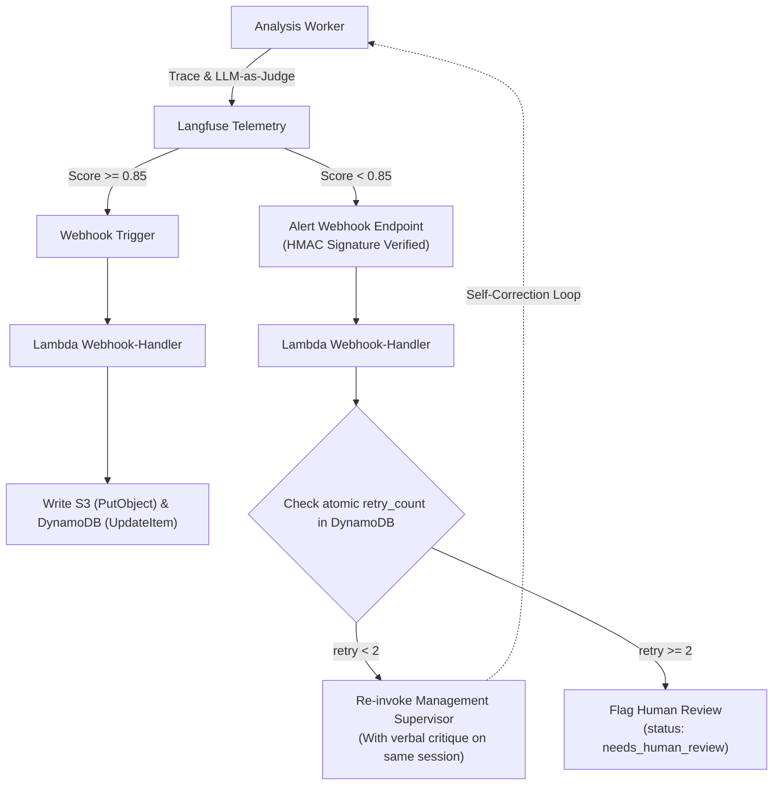

<div align="center">


# SignalScout - Strategic Change Radar

> **An evidence-first, multi-agent early-warning system on AWS that connects scattered corporate-restructuring signals into one auditable risk story - every claim traceable to its verified source.**

[](https://awsbuildweek.dev)


*Our team celebrating at Agentic AI Build Week 2026*

</div>

---

### We did it!

A massive thank you to the **AWS Build Week** organizers, judges, mentors, and every teammate who poured weekends and late nights into making SignalScout a reality. Being named **Runner Up on the AWS Track** validates our vision: corporate restructuring intelligence should be evidence-first, temporally honest, deterministically scored, and fully auditable - no hallucinations, no guesswork.

---

<div align="center">

[Video Demo](https://youtu.be/c9ZgQTMOngM) &bull; [Interactive IaC Diagram](https://raw.githack.com/VectorisLabs/SignalScout/main/docs/diagrams/terraform-provision-workflow.html) &bull; [Quickstart](#quickstart) &bull; [System Architecture](#system-architecture) &bull; [Documentation Map](#documentation-map)

</div>

---

## Executive Overview

Enterprise risk rarely arrives as one clear headline.

Public disclosures and restructuring events accumulate across fragmented sources over months: workforce reductions, cancelled debt exchanges, delayed SEC filings, credit covenant defaults, repeated financing amendments, and sudden leadership departures. In isolation, each event often has a benign explanation. The real risk lies in the **cluster** - and how that cluster evolves over time.

Today, enterprise risk analysts, procurement leads, and commercial-exposure teams monitor counterparties through manual searches, spreadsheets, disconnected news alerts, and subjective analyst judgment. This workflow is slow, difficult to audit, and systematically vulnerable to missing subtle connections spread across disparate documents and publication dates.

**The 2023 collapse of Bed Bath & Beyond illustrates the problem.** Over eight months prior to its Chapter 11 filing on April 23, 2023, public evidence mounted steadily: corporate layoffs, cancelled debt exchanges, delinquent reporting, lender covenant defaults, and distressed financing amendments. For a supplier extending unsecured credit or a buyer managing supply-chain continuity, these were critical early indicators to adjust payment terms, recalibrate shipment volumes, and secure alternative channels.

SignalScout transforms scattered corporate disclosures into an auditable, temporal early-warning intelligence radar. Every factual claim is rooted in immutable public evidence, scored by deterministic code, challenged by an adversarial AI, and self-corrected through an automated Reflexion loop on Amazon Bedrock AgentCore.

---

## Target User & Strategic Postures

SignalScout is engineered for strategy, competitive-intelligence, enterprise-risk, procurement, supplier-risk, and commercial-exposure analysts preparing executive decision reviews.

### Job to Be Done

> "When a watched company begins restructuring, show me the evidence cluster, the financial and operating metrics affected, the plausible response scenarios, and what leadership should review next."

### Core Executive Postures

SignalScout frames findings into three distinct **review postures** (decision support, not autonomous actions):

| Posture | Strategic Intent | Operational Meaning |
|---|---|---|
| `MAINTAIN` | Monitor and Preserve | Maintain the current operating plan while monitoring risk signal velocity. |
| `ADAPT` | Bounded Adjustments | Implement bounded changes to credit limits, shipment volumes, inventory, pricing, or vendor exposure. |
| `ACCELERATE` | Capture Advantage | Act decisively to capture market share or talent while the counterparty is structurally distracted. |

---

## Quickstart

Experience SignalScout locally in under 3 minutes through two zero-cloud-cost pathways.

### Track 1: Interactive Web Replay Dashboard

Explore the historical backtest replay interface for Bed Bath & Beyond (2023) and Intel (2024) with pre-packaged, validated evidence bundles:

```bash
# 1. Clone repository
git clone https://github.com/VectorisLabs/SignalScout.git
cd SignalScout

# 2. Install workspace dependencies
npm install

# 3. Launch the development workspace (Backend + Frontend)
npm run dev
```

Open `http://localhost:5173` in your browser to interact with the timeline replay, inspect citation excerpts down to verified source URLs, review adversarial Challenger counterarguments, and explore executive posture recommendations.

### Track 2: Zero-Cloud-Cost IaC Offline Verification

Verify the entire production AWS Terraform infrastructure offline in 2 seconds using native Terraform mock providers (`mock_provider "aws"`):

```bash
# Execute end-to-end plan-mode unit tests across all 5 modules and production root
terraform -chdir=signalscout-prod/terraform/environments/prod test
```

This validates 100% of the HCL logic, least-privilege IAM policies, S3 Intelligent-Tiering transitions, DynamoDB On-Demand tables, HTTP API Gateway routing, and CloudWatch alarms without requiring live AWS credentials, network access, or cloud costs.

> **Local Emulation Note:** To execute live plan and apply cycles against a local Quarkus Native container, see the [Operator Guide (Floci Emulation)](docs/baseline/terraform-prod.useguide.md#2-local-floci-emulation-workflow).

---

## System Architecture

SignalScout is built as a serverless, multi-agent **supervisor-worker** system running on **Amazon Bedrock AgentCore Runtime** with the **AWS Strands Agents SDK**.


### Multi-Agent Topology

| Agent | Architecture Role | Foundation Model | Tooling & Isolation |
|---|---|---|---|
| **Management** (Supervisor) | Orchestrates the pipeline via a star pattern; invokes workers sequentially; workers never communicate directly | Claude Sonnet (Bedrock) | `InvokeAgentRuntime` (A2A protocol) |
| **Crawler** (Worker) | Collects candidate documents from IR pages, news, and filings; sanitizes and filters JSON in plain code before model ingestion | Claude Sonnet (Bedrock) | TinyFish Search/Fetch/Agent, Apify Actors |
| **Analysis** (Worker) | Performs risk reasoning and theme correlation across structured evidence; guarded against prompt injection | Claude Sonnet (Bedrock) + Guardrails | Payload-only input; no external network tools |
| **Challenger** (Adversary) | Challenges hypotheses, searches for benign explanations, and weakens ungrounded claims | GPT (OpenAI, cross-model) | Evidence pack only; cross-model bias mitigation |

The Challenger deliberately operates on a **different model family** (GPT vs. Claude) to eliminate correlated blind spots. An executive alert fires only when `risk_score >= T_alert` (0.75) **and** the Challenger does not weaken the core hypothesis.

### Self-Correction Loop (Reflexion)

SignalScout implements an automated Reflexion self-correction loop to guarantee factual consistency:



1. Every reasoning pass exports telemetry and an LLM-as-Judge evaluation score to **Langfuse**.
2. A high evaluation score triggers a webhook that invokes the Webhook-Handler Lambda to persist results.
3. A low score triggers an alert webhook hitting a dedicated HMAC-verified API Gateway endpoint.
4. The Lambda inspects an atomic `retry_count` in DynamoDB:
   - If under the retry ceiling (`MAX_RETRY = 2`), it re-invokes the Management supervisor on the same session, injecting an actionable verbal `critique` detailing the exact deficiency.
   - If the limit is reached, it sets status to `needs_human_review` and halts execution, guaranteeing fail-safe termination.

### Decoupled Data Flow: Write vs. Read

| Phase | Execution Flow | Architectural Rationale |
|---|---|---|
| **Write Lifecycle** (Pipeline completion) | Lambda Webhook-Handler &rarr; S3 (`PutObject`) &rarr; DynamoDB (`UpdateItem`) | Writing to S3 first prevents DynamoDB records from referencing non-existent objects if storage fails. |
| **Read Lifecycle** (Dashboard access) | Browser &rarr; AppSync &rarr; DynamoDB lookup &rarr; S3 Presigned URL &rarr; Direct download | Retrieving the S3 key from DynamoDB enables generation of short-lived presigned URLs for private asset retrieval. |

---

## Architecture v2 - AWS-Native Optimization

The second architecture iteration introduces an AWS-native tool gateway and memory layer for enhanced operational efficiency and distributed observability:


| Architectural Enhancement | Implementation Mechanism | System Benefit |
|---|---|---|
| **AgentCore Gateway + MCP** | Replaces direct HTTPS calls with a centralized MCP tool gateway | Centralized tool registry, unified rate limiting, and zero agent code changes when updating scrapers |
| **AgentCore Memory (Short Memory)** | Dedicated session state managed by the Management supervisor | Eliminates re-fetching context across retries, reducing Bedrock token consumption in Reflexion loops |
| **Distributed Tracing with X-Ray** | Integrated alongside Amazon CloudWatch and AWS CloudTrail | End-to-end trace correlation across multi-agent A2A handoffs and Lambda webhook handlers |
| **Decoupled Trace Export Lambda** | Dedicated Lambda routing between Analysis and Langfuse | Cleanly isolates webhook processing from observability telemetry dispatch |

---

## Engineering Deep-Dives

### Deterministic Signal Scoring

Risk scoring in SignalScout is **pure code** - foundation models never compute, override, or hallucinate risk scores.

```text
base(company, t) = Sum [ w(event_type) * magnitude * exp(-days_since / 30) ]
                   (evaluated across a 90-day rolling window; strongest signal per type)

score = min(1.0, base + synergy_bonus)
```

- `T_investigate = 0.55`: Triggers multi-agent investigative reasoning and structured timeline replay.
- `T_alert = 0.75`: Triggers executive early-warning notification (requires Challenger non-weakening).

#### Why Deterministic?

- **Reproducible**: Identical inputs always produce identical scores without model temperature drift.
- **Auditable**: Analysts and compliance officers can trace exactly why a score changed down to source signal weights.
- **Tunable**: Risk weights and synergy thresholds live in version-controlled configuration, not latent model behavior.
- **Safe**: Foundation models draft explanations, but deterministic code decides whether those explanations are admissible.

<details>
<summary>View Full 7-Event Taxonomy and Synergy Bonus Rules</summary>

#### Event Taxonomy (7 Types, Fixed Schema)

| Event Type | Weight | Description & Magnitude Examples |
|---|---|---|
| `debt_event` | 0.30 | Going-concern warning (1.0), credit downgrade or covenant breach (0.8), distressed refinancing (0.5) |
| `exec_departure` | 0.25 | CEO or CFO resignation/termination (0.9), COO/CTO (0.7), VP/board member (0.4) |
| `layoff` | 0.22 | Major workforce reduction >8% (0.9), 3% - 8% (0.6), minor reduction <3% (0.3) |
| `guidance_cut` | 0.20 | Dividend suspension (0.9), lowered revenue/profit guidance (0.6), capex reduction (0.5) |
| `asset_sale` | 0.18 | Sale of core strategic business unit (0.8), non-core facility/asset liquidation (0.5) |
| `facility_closure` | 0.12 | Multiple store/factory closures (0.7), single facility consolidation (0.3) |
| `hiring_freeze` | 0.10 | Enterprise-wide hiring freeze (0.6), single department freeze (0.3) |

#### Synergy Bonus Matrix

When critical events co-occur within the 90-day window, non-linear risk compounding is applied:

| Event Combination | Synergy Bonus | Rationale |
|---|---|---|
| `layoff` + `debt_event` | +0.15 | Operational contraction coupled with liquidity pressure signals severe cash distress. |
| `exec_departure(CFO)` + `debt_event` | +0.15 | Financial leadership change during credit negotiations indicates internal accounting distress. |
| `layoff` + `exec_departure` | +0.10 | Dual disruption in human capital and executive governance. |
| `asset_sale` + `debt_event` | +0.10 | Forced asset disposal to service maturing obligations. |
| 4+ Distinct Event Types | +0.15 | Broad-spectrum multi-vector operational breakdown. |

</details>

### Evidence Gate & Temporal Integrity

Before any candidate document reaches model reasoning or public presentation, the Evidence Gate enforces strict fail-closed validation:

- **Entity Resolution**: Exact CIK, legal entity, and ticker matching.
- **Authoritative Provenance**: Canonical source URL and SEC accession number.
- **Strict Temporal Boundary**: Enforces `publicly_available_at <= replay_as_of` to prevent hindsight bias.
- **Immutable Hashing**: Cryptographic SHA-256 verification of frozen source HTML/PDF content.
- **Source Deduplication**: Identical disclosures across multiple syndication outlets are normalized to a single evidence entity.
- **Fail-Closed Gate**: Missing any mandatory attribute blocks candidate ingestion immediately.

### Trust Boundaries & Defense-in-Depth

| Subsystem | Trusted Role | Untrusted Input Vector | Security Control |
|---|---|---|---|
| **Search Engine** | URL Discovery | Malicious SERP rankings, prompt injection in snippets | Domain allowlists, query parameter sanitization, strict deduplication |
| **Web Fetcher** | Raw Retrieval | Remote web payloads, hidden CSS prompt injections | Content-type validation, HTML stripping, max body size limits |
| **Evidence Store** | Fact Repository | Unverified document excerpts | Cryptographic SHA-256 validation, temporal eligibility checks |
| **Model Reasoning** | Risk Synthesis | Adversarial jailbreaks embedded in unstructured news | Mandatory Amazon Bedrock Guardrails, fail-closed JSON schema enforcement |
| **User Interface** | Visualization | Stale or ungrounded claims | Render blockers on unverified evidence IDs, citation resolution checks |

#### Guardrails Placement

| Runtime Layer | Guardrails Attached? | Architectural Rationale |
|---|---|---|
| **Management** (Supervisor) | Conditional | Attached only when supervisor uses LLM reasoning to route worker flows (defense-in-depth). |
| **Crawler** (Worker) | No | Pure code sanitization strips malicious HTML/scripts; model does not perform reasoning on raw text. |
| **Analysis** (Worker) | **Mandatory** | Untrusted external text enters deep foundation model reasoning; highest prompt-injection risk surface. |

<details>
<summary>View Collector Routing Policy and Invariant Rules</summary>

#### Collector Routing Hierarchy

TinyFish and Apify are invoked as model tools within the Crawler subagent following deterministic rules in code:

1. **Approved Internal Cache**: Fast-path cache lookup for immutable filings.
2. **Official Structured APIs**: SEC EDGAR direct ingestion.
3. **TinyFish Search**: URL discovery when target destination is unindexed.
4. **TinyFish Fetch**: Clean content extraction for 1 - 10 known URLs.
5. **TinyFish Agent**: Adaptive browser interaction for complex investor-relations pages.
6. **Apify Actors**: Batch news scraping (>10 URLs) and recurring news feeds.
7. **Human Escalation**: Fallback when automated extraction is disallowed by policy.

#### Non-Negotiable Rules

1. Prefer official structured APIs over every crawler.
2. Treat every TinyFish/Apify result as `UNTRUSTED_SOURCE_CANDIDATE`.
3. A candidate becomes evidence only after the Evidence Gate approves it.
4. Never expose API keys, credentials, or private URLs to model, UI, or logs.
5. Never send raw collector output into scoring or factual conclusions.
6. Stop when the evidence request is satisfied or budget is exhausted.
7. Do not call a more expensive tool when a cheaper one suffices.

#### Per-Review Enforced Budget

```json
{
  "max_official_api_calls": 10,
  "max_tinyfish_search_calls": 2,
  "max_fetch_urls": 10,
  "max_tinyfish_agent_runs": 1,
  "max_apify_runs": 1,
  "max_total_candidates": 20,
  "max_collection_rounds": 2
}
```

</details>

<details>
<summary>View 12 Core Architectural Decisions</summary>

| # | Architecture Decision | Technical Rationale |
|---|---|---|
| 1 | Multi-agent supervisor-worker (star topology) | Provides centralized quality control, auditable handoffs, and decoupled worker scaling. |
| 2 | No Lambda-calls-Lambda or direct Runtime-calls-Runtime | Prevents double billing during synchronous waits and eliminates tight runtime coupling. |
| 3 | Direct HTTPS calls from AgentCore Runtime | Eliminates over-engineering an MCP gateway for single-tool workers in initial production. |
| 4 | TinyFish and Apify as model tools within Crawler | Allows the model to determine collection timing while selection rules stay in plain code. |
| 5 | Plain-code sanitization before model ingestion | Reduces Bedrock token consumption and mitigates prompt injection before model processing. |
| 6 | S3 Intelligent-Tiering with multi-attempt versioning | Optimizes storage lifecycle automatically while preserving full historical auditability. |
| 7 | DynamoDB atomic counter for `retry_count` | Guarantees race-condition prevention across concurrent asynchronous webhook retries. |
| 8 | Two DynamoDB tables (`MarketThemes` vs `PipelineState`) | Isolates public display records from sensitive operational telemetry (`session_id`, `critique`). |
| 9 | Mandatory Bedrock Guardrails on Analysis worker | Enforces defense-in-depth where untrusted external text enters deep model reasoning. |
| 10 | Cross-model Challenger (OpenAI GPT vs. Anthropic Claude) | Mitigates correlated model biases and hallucination loops through heterogeneous reasoning. |
| 11 | 100% Serverless consumption-based design | Ensures zero idle cost; AgentCore runtimes are not billed during external I/O waits. |
| 12 | Dedicated signature-verified webhook API Gateway | Decouples third-party Langfuse callbacks (HMAC verified) from user Cognito JWT auth. |

</details>

### Cost Optimization

- **100% Serverless**: Zero operational infrastructure cost when idle.
- **Amazon API Gateway HTTP API**: Approximately 70% cheaper than REST API alternatives.
- **Amazon Bedrock On-Demand**: Pay-per-token model with zero Provisioned Throughput commitment fees.
- **AgentCore Non-Billing on I/O**: AgentCore runtime is not billed while waiting for external LLM or partner responses.
- **S3 Intelligent-Tiering**: Automatically shifts inactive evidence objects across access tiers without retrieval fees.
- **Code-Level Filtering**: Heuristic data stripping in plain code minimizes token volume sent to Bedrock models.
- **DynamoDB On-Demand**: True request-based pay-per-use billing with zero idle provisioning costs.
- **Amazon Cognito Free Tier**: Supports up to 50,000 Monthly Active Users (MAU) at zero charge.
- **Event-Driven Push Model**: Uses webhooks and A2A invocations instead of costly polling loops.

---

## Backtest Validation

SignalScout was rigorously validated across historical enterprise restructuring events:

| Target Company | Evaluation Period | Disclosed Real-World Signals | Scoring Response & Lead Time |
|---|---|---|---|
| **Bed Bath & Beyond** | Aug 2022 - Apr 2023 | 20% workforce layoff, dividend pause, debt exchange cancellation, covenant default, repeated financing amendments | Alert triggered in **January 2023** (`score >= 0.75`), providing suppliers and counterparties **3+ months of actionable lead time** prior to Chapter 11 filing (April 23, 2023). |
| **Intel Corporation** | Aug 2024 - Dec 2024 | 15% workforce cut (~15k staff), dividend suspension, $10B capex reduction, Altera unit spin-off talks, CEO departure | Alert triggered **immediately on August 1, 2024** driven by non-linear synergy bonus (`layoff` + `guidance_cut` co-occurring on same trading day). |

---

## Infrastructure as Code & DevSecOps Workflow

SignalScout provisions its entire cloud footprint through modular Terraform configurations (`signalscout-prod/terraform/modules/` and `signalscout-prod/terraform/environments/prod/`), implementing a zero-cloud-cost local emulation pipeline alongside production AWS deployment.


> **Interactive Architecture Diagram:** Explore the [interactive standalone workflow diagram](https://raw.githack.com/VectorisLabs/SignalScout/main/docs/diagrams/terraform-provision-workflow.html) featuring step-by-step trace animations, pan/zoom controls, and dark/light mode toggles.

### 3-Tier Delivery Pipeline

The provisioning lifecycle enforces a strict 3-tier DevSecOps progression:

- **Tier 1: Local Development & Static Verification**: Zero-comment policy (`#`) enforced across all `.tf` files with technical rationale embedded in `description` attributes; canonical formatting verification (`terraform fmt -check`); syntax validation (`terraform validate`); and 100% offline unit test coverage (`terraform test` with mock AWS provider) verifying IAM policies, encryption standards, and tags without AWS credentials.
- **Tier 2: Floci Local Emulation & Runtime Testing**: Zero-cost containerized testing on the Quarkus Native Floci emulator (`http://localhost:4566`); dedicated local backend configuration (`backend-floci.hcl`) with path-style S3 state storage; and API feature-isolation flags (`floci.tfvars`) toggling emulator boundaries, successfully provisioning and verifying 26 core resources (S3, DynamoDB, IAM, Secrets Manager, HTTP API Gateway, Lambda, CloudWatch) via AWS CLI before cloud deployment.
- **Tier 3: AWS Cloud Production & Governance**: Production backend configuration (`backend-prod.hcl`) leveraging remote S3 state with native S3 state locking (`use_lockfile = true`) for concurrency safety; comprehensive execution plan generation (`terraform plan -var-file=terraform.tfvars`); and mandatory Human Approval Gate (autonomous apply operations are strictly prohibited by policy, requiring explicit, documented sign-off before deploying to AWS region `ap-southeast-1`).

---

## Documentation Map

SignalScout maintains a comprehensive baseline documentation pack and architectural decision ledgers:

| Category | Document | Primary Scope & Contents |
|---|---|---|
| **Business Scope** | [Product Definition](docs/business/product-definition.md) | Problem formulation, user personas, review postures, and explicit non-claims |
| **Business Scope** | [Domain Invariants](docs/business/domain-invariants.md) | 13 mandatory domain invariants governing regulated wealth-management workflows |
| **Business Scope** | [Signal Taxonomy](docs/business/signal-taxonomy.md) | Formal signal taxonomy, magnitude scales, and temporal decay policies |
| **Production Architecture** | [System Architecture](docs/production/architecture.md) | Production architecture specification, component inventory, and network topologies |
| **Production Architecture** | [Design Rationale](docs/production/design-rationale.md) | Technical reasoning behind supervisor-worker patterns and serverless selection |
| **Production Architecture** | [Decision Ledger](docs/production/decision-ledger.md) | Complete historical record of production architecture choices |

---

## Business Invariants & Explicit Non-Claims

### Core Business Invariants

1. **Temporal integrity**: An evidence item is visible only when `publicly_available_at <= as_of`.
2. **Outcome isolation**: Known outcomes appear only after their public date and cannot influence earlier frames.
3. **Claim integrity**: Every factual claim references one or more approved evidence IDs.
4. **Source integrity**: Every evidence/metric source ID resolves in the source registry.
5. **Rights integrity**: Only approved excerpts in the public bundle - never raw page dumps.
6. **Deterministic authority**: Code owns score, stage, readiness, and blocking reasons - never AI.
7. **Missing-data honesty**: Unavailable data produces blockers, not invented values.
8. **Scenario humility**: Outputs are structured decision support, not certified forecasts.
9. **Replay reproducibility**: Identical input produces identical output.
10. **Offline reliability**: Provider failure never breaks the dashboard.

### Explicit Non-Claims

To maintain institutional compliance and scientific honesty, SignalScout operates under strict, load-bearing non-claims:

| Code | Non-Claim Policy | Institutional Invariant |
|---|---|---|
| `NOCLAIM-01` | **Not a bankruptcy predictor** | SignalScout identifies when a cluster becomes urgent enough to warrant human analyst review. |
| `NOCLAIM-02` | **Not a calibrated probability** | The risk score is an explainable composite heuristic, not an actuarial probability. |
| `NOCLAIM-03` | **Decision support, not autonomous authority** | Recommendations frame choices for human leadership; they never execute financial or legal transactions. |
| `NOCLAIM-04` | **Retrospective replay honesty** | Historical replays represent what was publicly known at time `t`, strictly excluding future leakage. |

---

## Built With

- **Cloud Infrastructure (AWS)**: Amazon Bedrock AgentCore Runtime, Amazon Bedrock & Guardrails, AWS Strands Agents SDK, AWS Lambda, Amazon API Gateway (HTTP API), AWS AppSync (GraphQL), AWS Amplify Gen 2, Amazon Cognito, Amazon DynamoDB (On-Demand), Amazon S3 (Intelligent-Tiering), AWS Secrets Manager, Amazon CloudWatch, AWS CloudTrail, AWS IAM.
- **AI & Reasoning Framework**: Anthropic Claude 3.5 Sonnet (Amazon Bedrock), OpenAI GPT (Challenger), TinyFish AI Web Agent, Apify Scraping Actors, Langfuse (Tracing, Prompt Management, LLM-as-Judge).
- **DevSecOps & Infrastructure as Code**: HashiCorp Terraform (v1.15.8), Native Mock Providers (`tftest`), Floci AWS Emulator (Quarkus Native), Docker.
- **Frontend & Interface**: React 18, Vite, TypeScript, TailwindCSS v4.
