

<a href="https://vectorislabs.github.io/SignalScout/landing/"><picture>
  <source media="(prefers-color-scheme: dark)" srcset="docs/assets/readme/hero-dark.webp">
  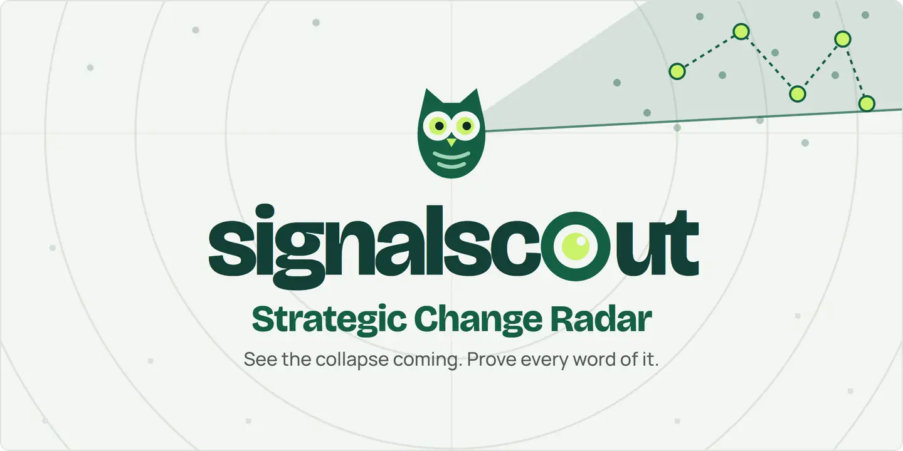
</picture></a>

<a href="https://youtu.be/c9ZgQTMOngM"><picture><source media="(prefers-color-scheme: dark)" srcset="docs/assets/readme/nav-video-dark.webp"></picture></a>
<a href="#how-it-works"><picture><source media="(prefers-color-scheme: dark)" srcset="docs/assets/readme/nav-how-dark.webp">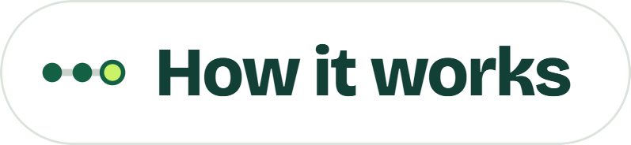</picture></a>
<a href="#architecture"><picture><source media="(prefers-color-scheme: dark)" srcset="docs/assets/readme/nav-architecture-dark.webp"></picture></a>
<a href="README.tech.md#quickstart"><picture><source media="(prefers-color-scheme: dark)" srcset="docs/assets/readme/nav-quickstart-dark.webp"></picture></a>
<a href="#engineering"><picture><source media="(prefers-color-scheme: dark)" srcset="docs/assets/readme/nav-engineering-dark.webp"></picture></a>
<a href="https://raw.githack.com/VectorisLabs/SignalScout/main/docs/diagrams/terraform-provision-workflow.html"><picture><source media="(prefers-color-scheme: dark)" srcset="docs/assets/readme/nav-iac-dark.webp"></picture></a>

---

*Our team celebrating at Agentic AI Build Week 2026*

### We did it!

A massive thank you to the **Agentic AI Build Week 2026** organizers, judges, mentors, and every teammate who poured weekends and late nights into making SignalScout a reality. Being named **Runner Up on the AWS Track** validates our vision: corporate restructuring intelligence should be evidence-first, temporally honest, deterministically scored, and fully auditable - no hallucinations, no guesswork.

---

## Risk never arrives as one headline

**SignalScout** is an evidence-first, multi-agent early-warning system on AWS that turns scattered corporate-restructuring signals into one auditable risk story.

<picture>
  <source media="(prefers-color-scheme: dark)" srcset="docs/assets/readme/stats-dark.webp">
  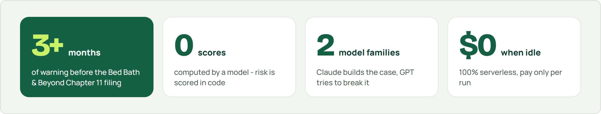
</picture>

Layoffs, a cancelled debt exchange, a covenant default, a CFO exit. Alone, each one has an excuse. **Together, they are the warning** - and most teams only see the cluster after the filing.

<picture>
  <source media="(prefers-color-scheme: dark)" srcset="docs/assets/readme/problem-dark.webp">
  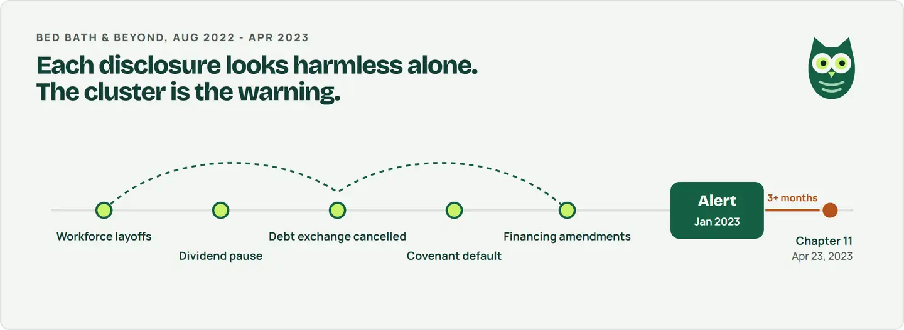
</picture>

SignalScout joins those dots the moment they are public, and shows its work for every one of them. Here is what changes for the team watching:

<picture>
  <source media="(prefers-color-scheme: dark)" srcset="docs/assets/readme/before-after-dark.webp">
  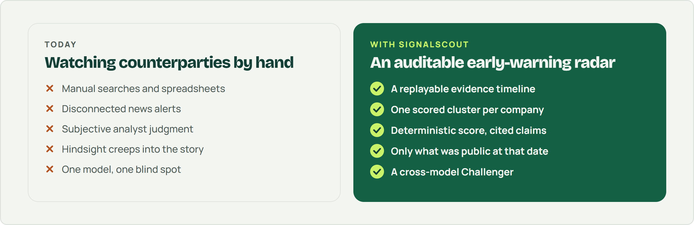
</picture>

**Built for** strategy, competitive-intelligence, enterprise-risk, procurement, supplier-risk and commercial-exposure analysts preparing executive decision reviews.

> *"When a watched company begins restructuring, show me the evidence cluster, the financial and operating metrics affected, the plausible response scenarios, and what leadership should review next."*

### Why you can trust the answer

<h4><picture><source media="(prefers-color-scheme: dark)" srcset="docs/assets/icon/shield-check-dark.svg"></picture>&nbsp; Nothing gets in unproven</h4>

A fail-closed Evidence Gate checks entity, source URL, public date and SHA-256 hash. Miss one, and the document is out.

<h4><picture><source media="(prefers-color-scheme: dark)" srcset="docs/assets/icon/hourglass-dark.svg"></picture>&nbsp; Zero hindsight</h4>

Evidence appears only when <code>publicly_available_at &lt;= as_of</code>. The past is replayed exactly as it was known.

<h4><picture><source media="(prefers-color-scheme: dark)" srcset="docs/assets/icon/logic-chip-dark.svg"></picture>&nbsp; Scored by code, not by AI</h4>

Models draft the explanation. Deterministic code owns the score, the stage and every blocker.

<h4><picture><source media="(prefers-color-scheme: dark)" srcset="docs/assets/icon/debate-dark.svg"></picture>&nbsp; It argues with itself</h4>

A GPT Challenger hunts for the benign explanation behind Claude's hypothesis. No alert while the case is weakened.

<h4><picture><source media="(prefers-color-scheme: dark)" srcset="docs/assets/icon/receipt-dark.svg"></picture>&nbsp; Every claim has a receipt</h4>

Each factual claim resolves to approved evidence IDs and a registered source.

<h4><picture><source media="(prefers-color-scheme: dark)" srcset="docs/assets/icon/data-gap-dark.svg"></picture>&nbsp; Honest about gaps</h4>

Missing data produces a blocker, never an invented value.

### What SignalScout will never claim

<h4><picture><source media="(prefers-color-scheme: dark)" srcset="docs/assets/icon/no-crystal-dark.svg"></picture>&nbsp; Not a bankruptcy predictor</h4>

It flags when a cluster is urgent enough for human analyst review.

<h4><picture><source media="(prefers-color-scheme: dark)" srcset="docs/assets/icon/no-dice-dark.svg"></picture>&nbsp; Not a calibrated probability</h4>

The score is an explainable composite heuristic, not an actuarial probability.

<h4><picture><source media="(prefers-color-scheme: dark)" srcset="docs/assets/icon/human-review-dark.svg"></picture>&nbsp; Decision support, not autonomous authority</h4>

Recommendations frame choices for leadership; they never execute financial or legal transactions.

<h4><picture><source media="(prefers-color-scheme: dark)" srcset="docs/assets/icon/rewind-dark.svg"></picture>&nbsp; Retrospective replay honesty</h4>

Replays show what was public at time <code>t</code>, with no future leakage.

---

## Architecture

A serverless, multi-agent **supervisor-worker** system on **Amazon Bedrock AgentCore Runtime** with the **AWS Strands Agents SDK**.

<h4><picture><source media="(prefers-color-scheme: dark)" srcset="docs/assets/icon/hub-dark.svg"></picture>&nbsp; Management - the supervisor</h4>

Orchestrates the pipeline in a star pattern; workers never talk to each other. Claude Sonnet on Bedrock, <code>InvokeAgentRuntime</code> over A2A.

<h4><picture><source media="(prefers-color-scheme: dark)" srcset="docs/assets/icon/crawl-dark.svg"></picture>&nbsp; Crawler - the collector</h4>

Collects IR pages, news and filings with TinyFish and Apify, and sanitizes them in plain code before any model sees them.

<h4><picture><source media="(prefers-color-scheme: dark)" srcset="docs/assets/icon/correlate-dark.svg"></picture>&nbsp; Analysis - the reasoner</h4>

Correlates risk themes across structured evidence. Claude Sonnet with mandatory Bedrock Guardrails, payload-only input, no network tools.

<h4><picture><source media="(prefers-color-scheme: dark)" srcset="docs/assets/icon/swords-dark.svg"></picture>&nbsp; Challenger - the adversary</h4>

GPT from a different model family attacks the hypothesis with the evidence pack only. An alert fires only when <code>risk_score &gt;= T_alert</code> (0.75) <b>and</b> the Challenger does not weaken it.

### Architecture v2 - AWS-native optimization

The same four agents, rewired to lean harder on AgentCore. v2 trims token spend in the Reflexion loop and makes every agent handoff traceable:

- **AgentCore Gateway + MCP** - one tool registry and rate limit for every scraper; updating a scraper needs no agent code change.
- **AgentCore Memory** - session state kept by the supervisor, so retries stop re-fetching context.
- **X-Ray tracing** - end-to-end traces across A2A handoffs and Lambda webhooks, next to CloudWatch and CloudTrail.
- **Trace-export Lambda** - observability dispatch to Langfuse, isolated from webhook processing.

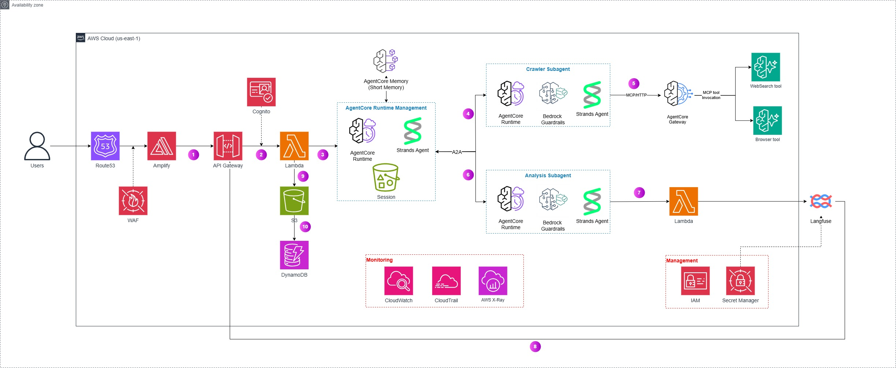

---

## How It Works

<picture>
  <source media="(prefers-color-scheme: dark)" srcset="docs/assets/readme/pipeline-dark.webp">
  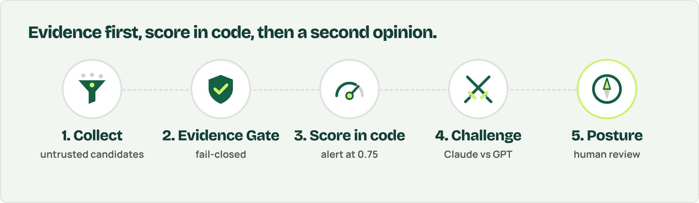
</picture>

<h4><picture><source media="(prefers-color-scheme: dark)" srcset="docs/assets/icon/funnel-dark.svg"></picture>&nbsp; 1. Collect</h4>

The Crawler gathers filings, investor-relations pages and news (SEC EDGAR, TinyFish, Apify) as untrusted candidates.

<h4><picture><source media="(prefers-color-scheme: dark)" srcset="docs/assets/icon/shield-check-dark.svg"></picture>&nbsp; 2. Evidence Gate</h4>

A fail-closed check on entity, canonical source URL, public date and SHA-256 hash admits a candidate as evidence.

<h4><picture><source media="(prefers-color-scheme: dark)" srcset="docs/assets/icon/gauge-dark.svg"></picture>&nbsp; 3. Score in code</h4>

Weighted, time-decaying event signals plus a synergy bonus; <code>T_investigate = 0.55</code> starts an investigation, <code>T_alert = 0.75</code> can raise an alert. No model computes the score.

<h4><picture><source media="(prefers-color-scheme: dark)" srcset="docs/assets/icon/swords-dark.svg"></picture>&nbsp; 4. Challenge</h4>

The Analysis worker (Claude) builds the hypothesis and a cross-model Challenger (GPT) looks for benign explanations.

<h4><picture><source media="(prefers-color-scheme: dark)" srcset="docs/assets/icon/compass-dark.svg"></picture>&nbsp; 5. Posture</h4>

The result is framed as a review posture for a human, with every claim cited - decision support, not autonomous action:

<picture><source media="(prefers-color-scheme: dark)" srcset="docs/assets/readme/posture-maintain-dark.webp">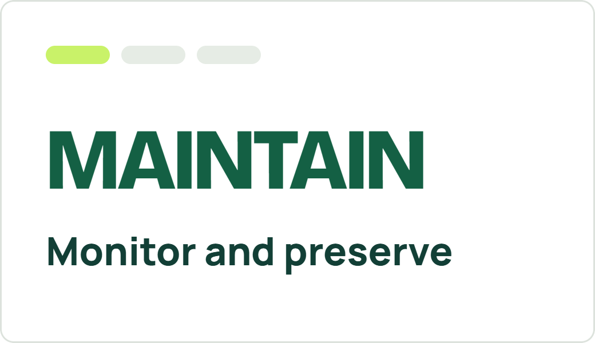</picture>
<picture><source media="(prefers-color-scheme: dark)" srcset="docs/assets/readme/posture-adapt-dark.webp">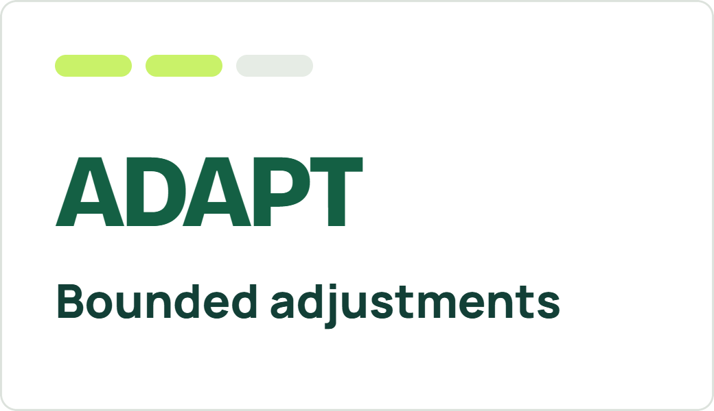</picture>
<picture><source media="(prefers-color-scheme: dark)" srcset="docs/assets/readme/posture-accelerate-dark.webp">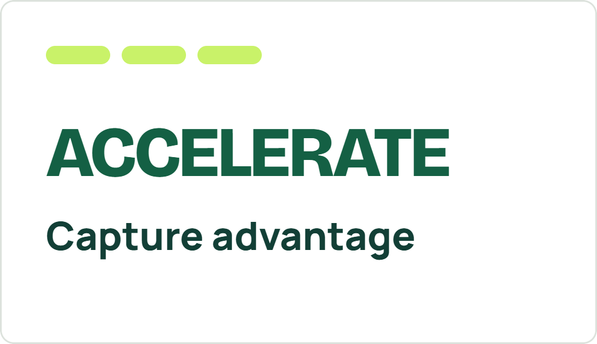</picture>

- **MAINTAIN** - keep the current operating plan while watching risk signal velocity.
- **ADAPT** - bounded changes to credit limits, shipment volumes, inventory, pricing or vendor exposure.
- **ACCELERATE** - move to capture market share or talent while the counterparty is distracted.

---

## Proven on real collapses

<h4><picture><source media="(prefers-color-scheme: dark)" srcset="docs/assets/icon/bag-dark.svg"></picture>&nbsp; Bed Bath &amp; Beyond - 3+ months early</h4>

Aug 2022 - Apr 2023: 20% layoff, dividend pause, debt exchange cancelled, covenant default, financing amendments. Alert in <b>January 2023</b> (<code>score &gt;= 0.75</code>) - <b>3+ months of lead time</b> before Chapter 11 on April 23, 2023.

<h4><picture><source media="(prefers-color-scheme: dark)" srcset="docs/assets/icon/trend-down-dark.svg"></picture>&nbsp; Intel - flagged on day one</h4>

Aug 2024 - Dec 2024: 15% workforce cut (~15k staff), dividend suspension, $10B capex cut, Altera spin-off talks, CEO departure. Alert <b>on August 1, 2024</b>, driven by the synergy bonus (<code>layoff</code> + <code>guidance_cut</code> on the same trading day).

---

## Engineering Deep-dive

<a href="README.tech.md"><picture><source media="(prefers-color-scheme: dark)" srcset="docs/assets/readme/tech-cta-dark.webp">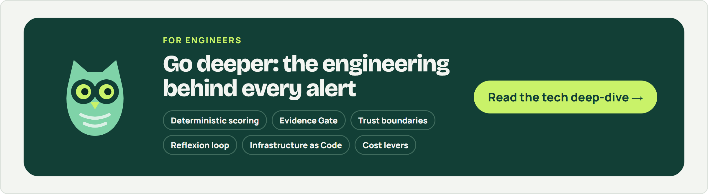</picture></a>

<a href="README.tech.md#architecture"><picture><source media="(prefers-color-scheme: dark)" srcset="docs/assets/readme/eng-architecture-dark.webp"></picture></a>
<a href="README.tech.md#self-correction-loop-reflexion"><picture><source media="(prefers-color-scheme: dark)" srcset="docs/assets/readme/eng-reflexion-dark.webp"></picture></a>
<a href="README.tech.md#deterministic-signal-scoring"><picture><source media="(prefers-color-scheme: dark)" srcset="docs/assets/readme/eng-scoring-dark.webp"></picture></a>
<a href="README.tech.md#evidence-gate--temporal-integrity"><picture><source media="(prefers-color-scheme: dark)" srcset="docs/assets/readme/eng-evidence-dark.webp"></picture></a>
<a href="README.tech.md#trust-boundaries--defense-in-depth"><picture><source media="(prefers-color-scheme: dark)" srcset="docs/assets/readme/eng-trust-dark.webp"></picture></a>
<a href="README.tech.md#cost-optimization"><picture><source media="(prefers-color-scheme: dark)" srcset="docs/assets/readme/eng-cost-dark.webp"></picture></a>
<a href="README.tech.md#infrastructure-as-code--devsecops-workflow"><picture><source media="(prefers-color-scheme: dark)" srcset="docs/assets/readme/eng-iac-dark.webp"></picture></a>
<a href="README.tech.md#core-business-invariants"><picture><source media="(prefers-color-scheme: dark)" srcset="docs/assets/readme/eng-invariants-dark.webp"></picture></a>
<a href="README.tech.md#quickstart"><picture><source media="(prefers-color-scheme: dark)" srcset="docs/assets/readme/eng-quickstart-dark.webp"></picture></a>
<a href="README.tech.md#documentation-map"><picture><source media="(prefers-color-scheme: dark)" srcset="docs/assets/readme/eng-docs-dark.webp"></picture></a>
<a href="README.tech.md#built-with"><picture><source media="(prefers-color-scheme: dark)" srcset="docs/assets/readme/eng-stack-dark.webp"></picture></a>

