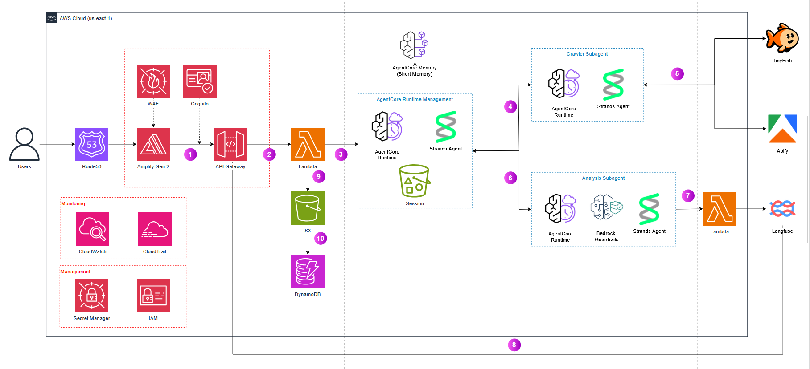
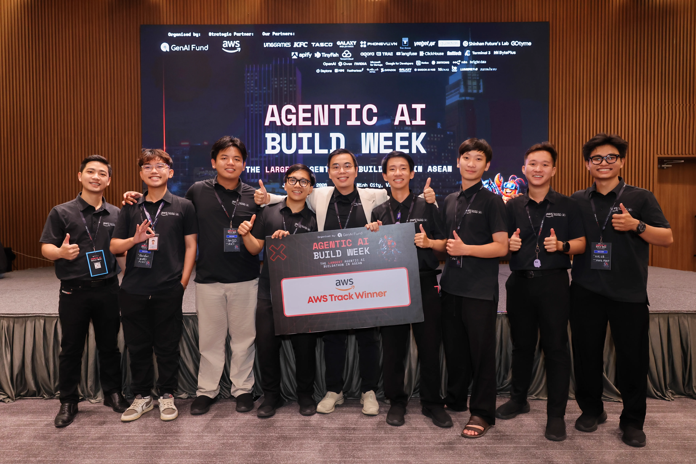

<div align="center">



# SignalScout - Strategic Change Radar

> **An evidence-first, multi-agent early-warning system on AWS that connects scattered corporate-restructuring signals into one auditable risk story - every claim traceable to its verified source.**

[](https://awsbuildweek.dev)



*Our team celebrating at Agentic AI Build Week 2026*

</div>

---

### We did it!

A massive thank you to the **AWS Build Week** organizers, judges, mentors, and every teammate who poured weekends and late nights into making SignalScout a reality. Being named **Runner Up on the AWS Track** validates our vision: corporate restructuring intelligence should be evidence-first, temporally honest, deterministically scored, and fully auditable - no hallucinations, no guesswork.

---

## The Problem

Enterprise risk rarely arrives as one clear headline.

A supplier may announce workforce reductions. Weeks later, it may terminate a debt exchange, file a financial report late, amend its credit agreement, or replace senior executives. Each event can have a reasonable explanation on its own. The real information lies in the **cluster** - and in how that cluster evolves over time.

Today, procurement, supply-chain, sales, and risk teams monitor counterparties through manual searches, spreadsheets, news alerts, and individual analyst judgment. This process is slow, difficult to audit, and especially weak at connecting small signals spread across different documents and dates.

**The 2023 collapse of Bed Bath & Beyond illustrates the problem.** Public evidence accumulated over several months - workforce reductions, a terminated debt exchange, delayed filings, credit-agreement defaults, repeated financing amendments - before the Chapter 11 filing on April 23, 2023. For a supplier extending unsecured credit, these were not merely financial-market events. They were signals to reconsider payment terms, shipment volumes, insurance coverage, and alternative distribution channels.

No single signal was alarming. The cluster was.

---

## What SignalScout Does

SignalScout converts verified public documents into structured risk signals and correlates them over time. The system focuses on one deeply researched case rather than pretending to monitor the entire market at once. The historical replay uses only evidence that was publicly available at each point in time.

### 1. Structures Raw Evidence

Each source document is converted into normalized events: workforce reduction, executive departure, debt/covenant event, delayed filing, guidance cut, asset sale, facility closure. Each signal carries a company identifier, event type, date, confidence, source URL, exact excerpt, and immutable evidence ID.

### 2. Calculates an Explainable Risk Score

A **deterministic** scoring function weights signals by type, confidence, source quality, and recency. Only the strongest event of each type contributes within a time window, preventing repeated news coverage from inflating the score. Synergy rules recognize dangerous combinations - a workforce reduction followed by a debt default, for example. The AI does not invent or override this score.

### 3. Builds a Historical Replay

The dashboard reconstructs what SignalScout would have known on each historical date. Future documents are excluded. As evidence accumulates, the case progresses through: `MONITORING → INVESTIGATING → HIGH RISK → OUTCOME`.

### 4. Challenges Its Own Conclusion

Before producing a final report, an AI **Challenger** (running on a different model family to reduce blind spots) searches for reasonable benign explanations: Was the workforce reduction a normal efficiency program? Was the financing amendment routine? The system records the strongest counterargument instead of hiding uncertainty.

### 5. Produces Evidence-Backed Actions

SignalScout generates persona-specific recommendations for procurement, sales, and risk teams. Every factual claim references an evidence ID. If supporting evidence is missing, the claim is rejected rather than displayed.

### 6. Lets Judges Inspect the Evidence Live

The historical replay is presented as a pre-recorded video for reliability. After the video, judges use the live dashboard to inspect the timeline, risk report, Challenger verdict, and recommended actions. Selecting a citation opens the exact source excerpt supporting that claim.

---

## Target User

Primary user: a strategy, competitive-intelligence, enterprise-risk, procurement, supplier-risk, or commercial-exposure analyst preparing an executive decision review.

### Job to be Done

> "When a watched company begins restructuring, show me the evidence cluster, the financial and operating metrics affected, the plausible response scenarios, and what leadership should review next."

### Core Decision

The executive chooses one posture:

- **MAINTAIN** - monitor and preserve the current plan.
- **ADAPT** - make bounded changes to pricing, inventory, channels, footprint, supplier exposure, or operating model.
- **ACCELERATE** - act aggressively while the competitor is distracted or structurally weakened.

These are **review postures**, not autonomous decisions. SignalScout is not a bankruptcy predictor, its story index is not a calibrated probability, and its scenarios are decision support rather than certified forecasts.

---

## Production Architecture

SignalScout is a fully serverless, multi-agent **supervisor-worker** system on **Amazon Bedrock AgentCore Runtime**, built with the **AWS Strands Agents SDK**.

```text
Users
  → Route 53 → AWS Amplify (Gen 2 hosting)
  → Amazon API Gateway (HTTP API, Cognito auth)
  → AWS Lambda
  → Bedrock AgentCore Runtime - Management (supervisor)
      ├── Crawler Subagent
      │     → TinyFish / Apify (model tools via tool_use, sync HTTPS)
      │     → Code-level sanitize & filter (before model)
      │     → S3 raw storage (multi-attempt, never overwrite)
      └── Analysis Subagent
            → Bedrock Guardrails (mandatory - untrusted content enters reasoning)
            → Theme + risk reasoning
            → Langfuse trace + LLM-as-Judge score export
  → DynamoDB (metadata + pipeline state)
  → AppSync → Lambda resolver → presigned URL → browser
  → React Dashboard
```

### Multi-Agent Topology

| Agent | Role | Model | Tools |
|-------|------|-------|-------|
| **Management** (supervisor) | Orchestrates using a star pattern - invokes each worker sequentially; workers never call each other | Claude Sonnet (Bedrock) | InvokeAgentRuntime (A2A protocol) |
| **Crawler** (worker) | Collects evidence, applies rule-based tool selection, sanitizes raw JSON in plain code before anything reaches the model | Claude Sonnet (Bedrock) | TinyFish Search/Fetch/Agent, Apify Actors |
| **Analysis** (worker) | Performs theme correlation and risk reasoning on clean, structured evidence | Claude Sonnet (Bedrock) + Guardrails | None - receives data via payload |
| **Challenger** | Searches for benign explanations, weakens or supports the hypothesis | GPT (OpenAI, cross-model) | None - evidence pack only |

The Challenger deliberately uses a **different model family** (GPT vs. Claude) to reduce correlated blind spots. An alert fires only when `risk_score >= T_alert` **and** the Challenger does not weaken the hypothesis.

### Self-Correction Loop (Reflexion)

```text
Analysis completes → export trace + LLM-as-Judge score → Langfuse
  ├── Score HIGH → Webhook → Lambda → write result (S3 + DynamoDB) → display on dashboard
  └── Score LOW  → Alert webhook → API Gateway (dedicated endpoint, HMAC-verified)
                    → Lambda Webhook-Handler
                    → Read retry_count (DynamoDB atomic counter)
                    → If retry_count < MAX: re-invoke Management with critique (same session)
                    → If retry_count >= MAX: flag "needs_human_review"
```

Every retry **must** include a verbal `critique` so the agent corrects the specific failure rather than repeating it.

### Data Flow: Write vs. Read

| Phase | Flow | Rationale |
|-------|------|-----------|
| **Write** (pipeline completes) | S3 first → DynamoDB second | Avoid DynamoDB pointing to a file that doesn't exist yet |
| **Read** (user opens dashboard) | DynamoDB first → S3 second (presigned URL) | Need the S3 key before generating a download URL |

These are two separate lifecycles - never chained into one.

---

## Deterministic Signal Scoring

The scoring engine is **pure code** - no model involvement.

### Event Taxonomy (7 types, fixed during build)

| Event Type | Weight | Magnitude Examples |
|-----------|--------|-------------------|
| `debt_event` | 0.30 | going-concern → 1.0, downgrade/covenant → 0.8, refinancing → 0.5 |
| `exec_departure` | 0.25 | CEO/CFO → 0.9, COO/CTO → 0.7, VP/board → 0.4 |
| `layoff` | 0.22 | >8% workforce → 0.9, 3-8% → 0.6, <3% → 0.3 |
| `guidance_cut` | 0.20 | Suspend dividend → 0.9, lower guidance → 0.6, cut capex → 0.5 |
| `asset_sale` | 0.18 | Strategic BU → 0.8, other → 0.5 |
| `facility_closure` | 0.12 | Multiple → 0.7, single → 0.3 |
| `hiring_freeze` | 0.10 | Company-wide → 0.6, single unit → 0.3 |

### Scoring Formula

```
base(company, t) = Sum [ w(event_type) x magnitude x exp(-days_since / 30) ]
                   (only strongest signal per event_type in 90-day window)

score = min(1.0, base + synergy_bonus)
```

**Synergy bonuses** (when both types co-occur in the window):

| Combination | Bonus |
|-------------|-------|
| layoff + debt_event | +0.15 |
| exec_departure(CFO) + debt_event | +0.15 |
| layoff + exec_departure | +0.10 |
| asset_sale + debt_event | +0.10 |
| 4+ different event types | +0.15 |

**Thresholds:**

- `T_investigate = 0.55` - triggers the multi-agent reasoning graph.
- `T_alert = 0.75` - eligible for alert (requires Challenger not weakening).

### Why Deterministic?

- Reproducible: same inputs always produce the same score.
- Auditable: analysts can trace exactly why a score changed.
- Tunable: weights live in configuration, not in model behavior.
- Safe: the AI drafts explanations, but code decides whether those explanations are admissible.

---

## Collector Routing Policy

TinyFish and Apify are invoked as **model tools** within the Crawler Subagent. Selection follows rules in code - there is no separate "Collector Router" service.

### Priority Order

```text
1. Approved internal cache
2. Official structured API (SEC EDGAR)
3. TinyFish Search (URL unknown, need discovery)
4. TinyFish Fetch (1-10 known URLs, need clean content)
5. TinyFish Agent (requires adaptive browser interaction)
6. Apify Actor (batch >10 URLs, recurring, tested actor exists)
7. Human evidence request (no permitted route)
```

### Non-Negotiable Rules

1. Prefer official structured APIs over every crawler.
2. Treat every TinyFish/Apify result as `UNTRUSTED_SOURCE_CANDIDATE`.
3. A candidate becomes evidence only after the Evidence Gate approves it.
4. Never expose API keys, credentials, or private URLs to model, UI, or logs.
5. Never send raw collector output into scoring or factual conclusions.
6. Stop when the evidence request is satisfied or budget is exhausted.
7. Do not call a more expensive tool when a cheaper one suffices.

### Per-Review Budget (application-enforced)

```json
{
  "max_official_api_calls": 10,
  "max_tinyfish_search_calls": 2,
  "max_fetch_urls": 10,
  "max_tinyfish_agent_runs": 1,
  "max_apify_runs": 1,
  "max_total_candidates": 20,
  "max_collection_rounds": 2
}
```

---

## Evidence Gate

Before any candidate enters scoring, reasoning, or the public UI, the Evidence Gate verifies:

- Legal entity and CIK
- Canonical source URL and accession (where applicable)
- Public `available_at` from authoritative metadata
- `available_at <= replay_as_of` (temporal integrity)
- Excerpt-to-observation support
- Frozen artifact and SHA-256 hash
- Duplicate source bundle identity
- Permitted source type and signal taxonomy
- Rights status for stored and displayed content
- Absence of later outcome leakage
- Curator approval

The gate is **fail-closed**: any missing field blocks the candidate. Approved output carries stable `evidence_id` values. AI claims must cite those IDs, not candidate IDs.

---

## Trust Boundaries and Safety

| Boundary | Trusted Role | Untrusted Input | Control |
|----------|-------------|----------------|---------|
| Search | URL discovery | Ranking, snippets | Allowlist/denylist, dedupe |
| Fetch | Text retrieval | Remote content, injection | Size limits, content-type checks, no instruction execution |
| Evidence | Historical facts | Unapproved excerpt | Source/evidence IDs, rights, `available_at` |
| Metrics | Structured observations | Ambiguous labels | Deterministic parsing, ambiguity rejection |
| LLM | Narrative draft | Hallucinated facts | JSON schema, tool allowlist, claim validator |
| Bundle | Judged artifact | Secrets, raw pages | Fail-closed validator |
| UI | Explanation | Readiness misrepresentation | Render blockers, provenance |

### Guardrails Placement

| Runtime | Guardrails? | Rationale |
|---------|-------------|-----------|
| Management | Conditional | Only if supervisor uses model reasoning to route (not just if/else) |
| Crawler | Typically no | Code-level sanitize handles it; model doesn't reason on raw content |
| **Analysis** | **Mandatory** | Untrusted web content enters model reasoning - highest injection risk |

---

## AWS Technology Stack

| Service | Role |
|---------|------|
| Amazon Route 53 | DNS |
| AWS Amplify Gen 2 | CI/CD from Git, CDN, React dashboard hosting |
| Amazon Cognito | User authentication (user pool + identity pool) |
| AWS WAF | Frontend and API protection |
| Amazon API Gateway (HTTP API) | User-facing endpoint + dedicated webhook endpoint |
| AWS Lambda | Trigger AgentCore, AppSync resolver, webhook handler |
| AWS AppSync | GraphQL API (Amplify Data) |
| Amazon Bedrock AgentCore Runtime | Host Strands Agents (Management, Crawler, Analysis) |
| Amazon Bedrock + Guardrails | Foundation model + safety filter |
| Amazon DynamoDB (On-Demand) | Two tables: `MarketThemes` (display) + `PipelineState` (operational) |
| Amazon S3 (Intelligent-Tiering) | Raw evidence + results, per-attempt without overwrite |
| AWS Secrets Manager | Partner API keys + webhook signing secret |
| Amazon CloudWatch | Logs, metrics, alarms |
| AWS CloudTrail | Account-wide audit trail (compliance) |
| AWS IAM | Least-privilege, one role per Runtime, specific ARNs, no wildcards |

### External Services

| Service | Role |
|---------|------|
| **TinyFish** | AI web agent - reads investor-relations pages, press releases, structured navigation |
| **Apify** | Web scraping actors - news sites, SEC filings, batch/recurring collection |
| **Langfuse** | LLM observability, tracing, LLM-as-Judge scoring, prompt management, self-correction webhook |
| **OpenAI** | Challenger agent (GPT) - cross-model bias reduction |

---

## Key Architectural Decisions

| # | Decision | Rationale |
|---|----------|-----------|
| 1 | Multi-agent supervisor-worker (star pattern) | Centralized quality control, traceable handoffs, independent worker scaling and reuse |
| 2 | No Lambda-calls-Lambda, no Runtime-calls-Runtime directly | Decouple via supervisor/S3; avoid double billing and tight coupling |
| 3 | AgentCore Runtime calls partners directly via HTTPS | No Gateway/MCP needed for single-agent single-tool (avoids over-engineering) |
| 4 | TinyFish/Apify as tool_use within Crawler | Model decides when to collect; selection rule stays in code |
| 5 | Filter/sanitize in plain code before model | Saves tokens, prevents injection, cheaper than model processing |
| 6 | S3 Intelligent-Tiering, multi-attempt never-overwrite | Unpredictable access pattern; history for replay, debug, compliance |
| 7 | DynamoDB atomic counter for retry_count | Prevents race conditions on concurrent retries |
| 8 | Two DynamoDB tables (display + operational) | Security: internal pipeline data never exposed to client |
| 9 | Guardrails mandatory at Analysis | Where untrusted web content enters model reasoning |
| 10 | Cross-model Challenger (GPT vs Claude) | Reduces correlated blind spots in hypothesis assessment |
| 11 | 100% serverless, consumption-based | No cost when idle; AgentCore not billed during I/O wait |
| 12 | Webhook endpoint separate from user-facing API | Langfuse doesn't support JWT; verify HMAC signature instead |

---

## Cost Optimization

- 100% serverless - zero cost when idle.
- API Gateway HTTP API (~70% cheaper than REST API).
- Bedrock On-Demand pricing (per token, no Provisioned Throughput).
- AgentCore not billed during I/O wait (waiting for LLM or partner responses).
- S3 Intelligent-Tiering auto-optimizes tier without retrieval fees.
- Code-level filtering before model input reduces Bedrock token consumption.
- DynamoDB On-Demand (pay per request).
- Cognito free tier (50,000 MAU).
- Event-driven architecture avoids polling.

---

## Backtest Validation

### Case A - Bed Bath & Beyond 2023

| Period | Event | Type |
|--------|-------|------|
| Aug 2022 | Workforce reductions, lower capex, store closures | layoff, guidance_cut, facility_closure |
| Jan 2023 | Debt exchange terminated, reporting delayed | debt_event |
| Feb-Mar 2023 | Credit-agreement defaults, lender waivers | debt_event |
| Mar-Apr 2023 | Repeated financing amendments | debt_event |
| Apr 23, 2023 | **Chapter 11** (ground truth) | - |

**Expected:** Score exceeds `T_alert` months before the Chapter 11 filing, giving suppliers and partners meaningful lead time.

### Case B - Intel 2024

| Period | Event | Type |
|--------|-------|------|
| Aug 1, 2024 | Layoff ~15% (~15k people) | layoff (mag 0.9) |
| Aug 1, 2024 | Suspend dividend from Q4 | guidance_cut (mag 0.9) |
| Aug 2024 | Cut capex >$10B plan 2025 | guidance_cut |
| Sep-Dec 2024 | Asset sale/spin-off talks (Altera) | asset_sale |
| Dec 2024 | CEO Gelsinger departs | exec_departure (mag 0.9) |

**Expected:** Alert immediately in Aug 2024 due to synergy (layoff + guidance_cut same day).

---

## Business Invariants

1. **Temporal integrity:** An evidence item is visible only when `publicly_available_at <= as_of`.
2. **Outcome isolation:** Known outcomes appear only after their public date and cannot influence earlier frames.
3. **Claim integrity:** Every factual claim references one or more approved evidence IDs.
4. **Source integrity:** Every evidence/metric source ID resolves in the source registry.
5. **Rights integrity:** Only approved excerpts in the public bundle - never raw page dumps.
6. **Deterministic authority:** Code owns score, stage, readiness, and blocking reasons - never AI.
7. **Missing-data honesty:** Unavailable data produces blockers, not invented values.
8. **Scenario humility:** Outputs are structured decision support, not certified forecasts.
9. **Replay reproducibility:** Identical input produces identical output.
10. **Offline reliability:** Provider failure never breaks the dashboard.

---

## What SignalScout Is Not

- **Not a bankruptcy predictor.** It recognizes when a cluster becomes important enough for humans to investigate.
- **Not a calibrated probability.** The score is an explainable composite, not a statistical forecast.
- **Not autonomous.** It supports decisions - it does not make them.
- **Not a real-time monitor.** It demonstrates the pattern on deeply researched historical cases.

---

## Built With

- Amazon Bedrock AgentCore (Runtime, Memory, Identity)
- Amazon Bedrock (foundation model + Guardrails)
- AWS Strands Agents SDK
- AWS Lambda
- Amazon API Gateway (HTTP API)
- AWS AppSync
- AWS Amplify (Gen 2 hosting)
- Amazon Cognito + AWS WAF
- Amazon Route 53
- Amazon DynamoDB
- Amazon S3 (Intelligent-Tiering)
- AWS Secrets Manager
- Amazon CloudWatch + AWS CloudTrail
- AWS IAM
- React + TypeScript
- TinyFish
- Apify
- Langfuse
- OpenAI
