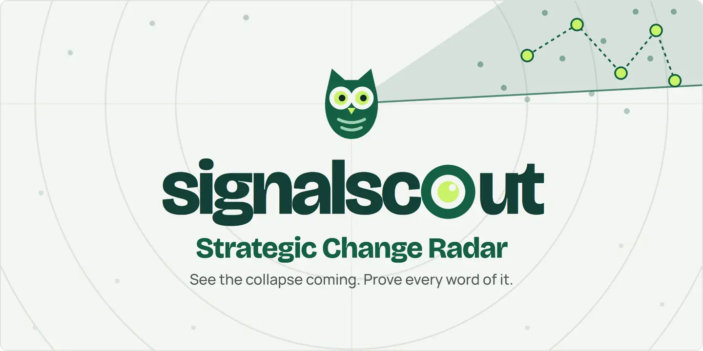
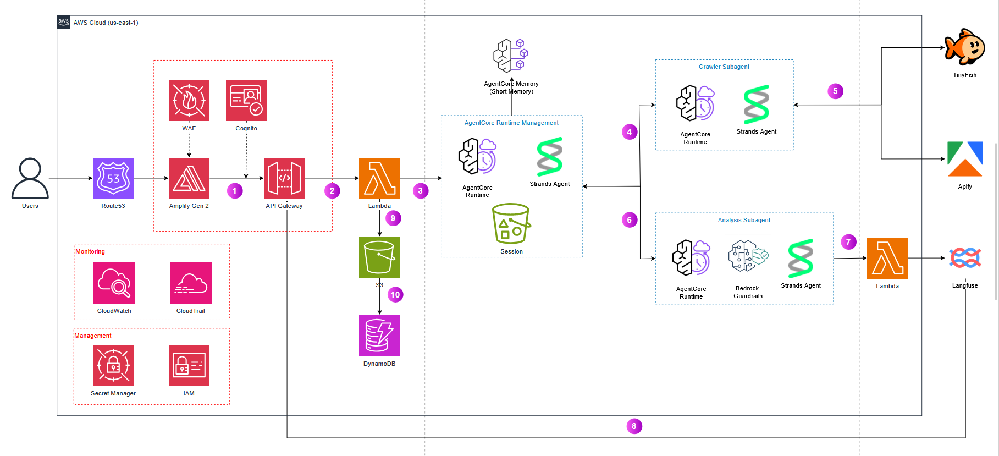
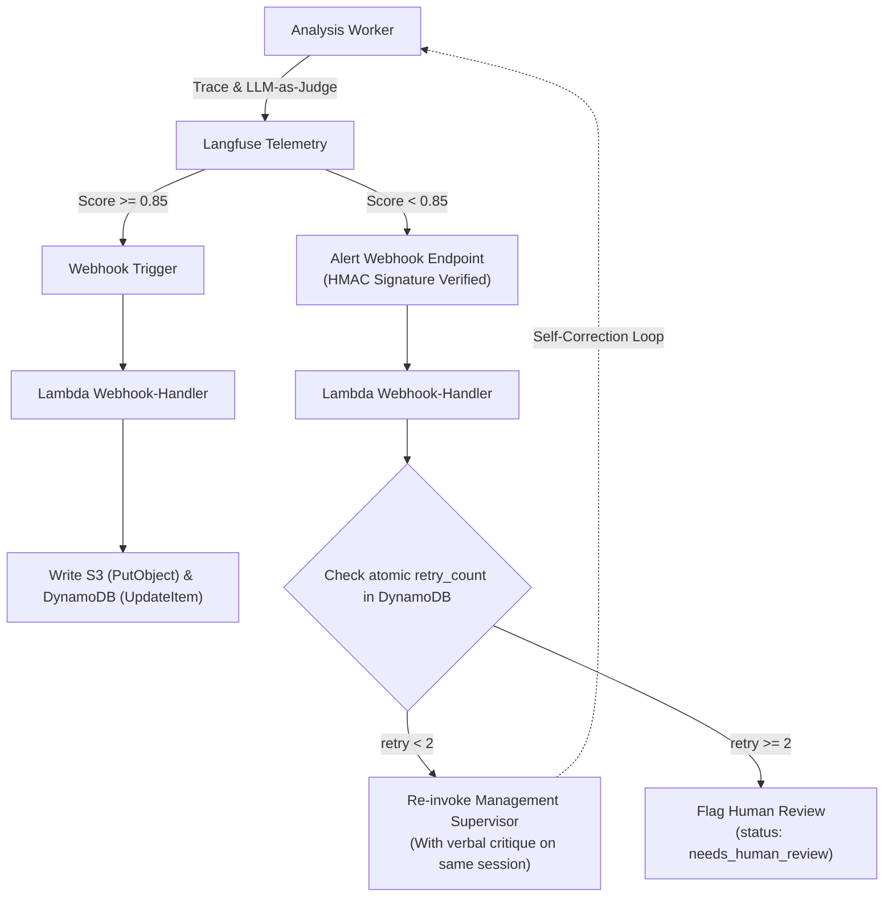
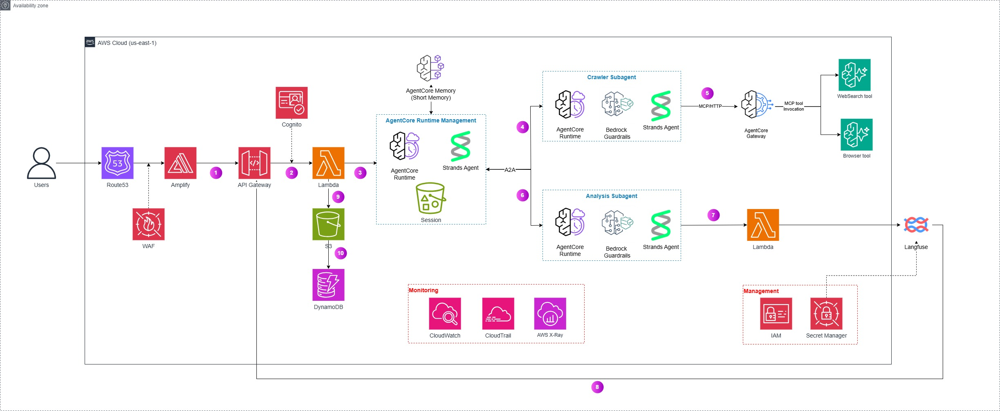
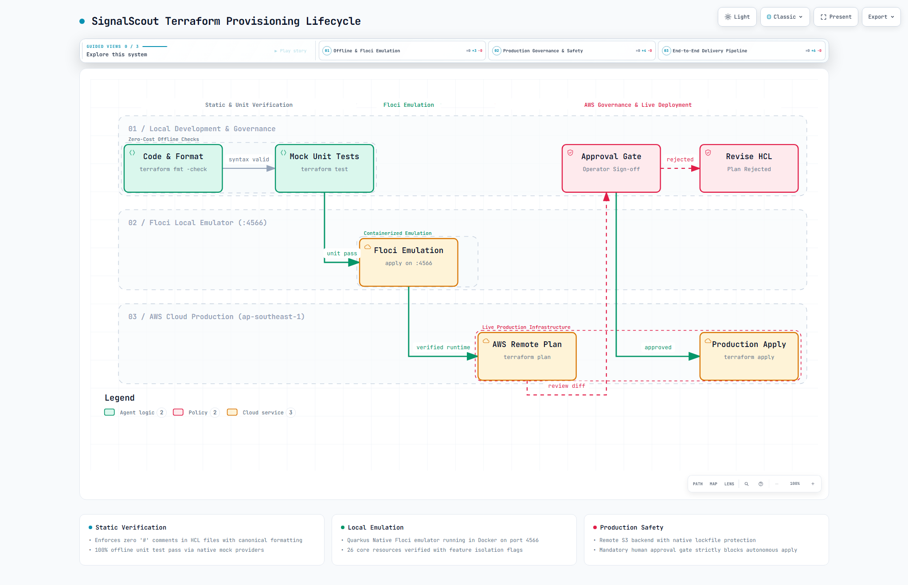

<div align="center">

<picture>
  <source media="(prefers-color-scheme: dark)" srcset="docs/assets/readme/hero-dark.webp">
  
</picture>

# Engineering Deep-dive

The engineering behind every alert: architecture, scoring, evidence integrity, trust boundaries, cost and infrastructure.

<a href="#quickstart"><picture><source media="(prefers-color-scheme: dark)" srcset="docs/assets/readme/eng-quickstart-dark.webp"></picture></a>
<a href="#architecture"><picture><source media="(prefers-color-scheme: dark)" srcset="docs/assets/readme/eng-architecture-dark.webp"></picture></a>
<a href="#self-correction-loop-reflexion"><picture><source media="(prefers-color-scheme: dark)" srcset="docs/assets/readme/eng-reflexion-dark.webp"></picture></a>
<a href="#deterministic-signal-scoring"><picture><source media="(prefers-color-scheme: dark)" srcset="docs/assets/readme/eng-scoring-dark.webp"></picture></a>
<a href="#evidence-gate--temporal-integrity"><picture><source media="(prefers-color-scheme: dark)" srcset="docs/assets/readme/eng-evidence-dark.webp"></picture></a>
<a href="#trust-boundaries--defense-in-depth"><picture><source media="(prefers-color-scheme: dark)" srcset="docs/assets/readme/eng-trust-dark.webp"></picture></a>
<a href="#cost-optimization"><picture><source media="(prefers-color-scheme: dark)" srcset="docs/assets/readme/eng-cost-dark.webp"></picture></a>
<a href="#infrastructure-as-code--devsecops-workflow"><picture><source media="(prefers-color-scheme: dark)" srcset="docs/assets/readme/eng-iac-dark.webp"></picture></a>
<a href="#core-business-invariants"><picture><source media="(prefers-color-scheme: dark)" srcset="docs/assets/readme/eng-invariants-dark.webp"></picture></a>
<a href="#documentation-map"><picture><source media="(prefers-color-scheme: dark)" srcset="docs/assets/readme/eng-docs-dark.webp"></picture></a>
<a href="#built-with"><picture><source media="(prefers-color-scheme: dark)" srcset="docs/assets/readme/eng-stack-dark.webp"></picture></a>

[&larr; Back to README](README.md)

</div>

---

## Quickstart

Two zero-cloud-cost paths, under 3 minutes.

<h4><picture><source media="(prefers-color-scheme: dark)" srcset="docs/assets/icon/play-dark.svg"></picture>&nbsp; 1. Replay dashboard</h4>
<p>Bed Bath &amp; Beyond (2023) and Intel (2024) with pre-packaged, validated evidence bundles.</p>

```bash
git clone https://github.com/VectorisLabs/SignalScout.git
cd SignalScout
npm install
npm run dev
```

Open `http://localhost:5173`: replay the timeline, open citations down to the source URL, read the Challenger's counterarguments, and explore posture recommendations.

<h4><picture><source media="(prefers-color-scheme: dark)" srcset="docs/assets/icon/terminal-dark.svg"></picture>&nbsp; 2. Offline IaC verification</h4>
<p>Plan-mode unit tests across all 5 Terraform modules and the production root, with native mock providers (<code>mock_provider "aws"</code>). No AWS credentials, no network, no cost.</p>

```bash
terraform -chdir=signalscout-prod/terraform/environments/prod test
```

> Live plan and apply against the local Floci emulator: see the [Operator Guide](docs/baseline/terraform-prod/terraform-prod.useguide.md).

---

## Architecture

A serverless, multi-agent **supervisor-worker** system on **Amazon Bedrock AgentCore Runtime** with the **AWS Strands Agents SDK**.



<h4><picture><source media="(prefers-color-scheme: dark)" srcset="docs/assets/icon/hub-dark.svg"></picture>&nbsp; Management - the supervisor</h4>
<p>Orchestrates the pipeline in a star pattern; workers never talk to each other. Claude Sonnet (Bedrock). Tools: <code>InvokeAgentRuntime</code> (A2A protocol).</p>

<h4><picture><source media="(prefers-color-scheme: dark)" srcset="docs/assets/icon/crawl-dark.svg"></picture>&nbsp; Crawler - worker</h4>
<p>Collects IR pages, news and filings; sanitizes JSON in plain code before any model sees it. Claude Sonnet (Bedrock). Tools: TinyFish Search/Fetch/Agent, Apify Actors.</p>

<h4><picture><source media="(prefers-color-scheme: dark)" srcset="docs/assets/icon/correlate-dark.svg"></picture>&nbsp; Analysis - worker</h4>
<p>Risk reasoning and theme correlation across structured evidence. Claude Sonnet (Bedrock) + Guardrails. Payload-only input; no external network tools.</p>

<h4><picture><source media="(prefers-color-scheme: dark)" srcset="docs/assets/icon/swords-dark.svg"></picture>&nbsp; Challenger - adversary</h4>
<p>Challenges hypotheses, searches for benign explanations, weakens ungrounded claims. GPT (OpenAI, cross-model). Evidence pack only.</p>

An executive alert fires only when `risk_score >= T_alert` (0.75) **and** the Challenger does not weaken the core hypothesis.

### Self-correction loop (Reflexion)



1. Every reasoning pass exports telemetry and an LLM-as-Judge evaluation score to **Langfuse**.
2. A high evaluation score triggers a webhook that invokes the Webhook-Handler Lambda to persist results.
3. A low score triggers an alert webhook hitting a dedicated HMAC-verified API Gateway endpoint.
4. The Lambda inspects an atomic `retry_count` in DynamoDB:
   - If under the retry ceiling (`MAX_RETRY = 2`), it re-invokes the Management supervisor on the same session, injecting an actionable verbal `critique` detailing the exact deficiency.
   - If the limit is reached, it sets status to `needs_human_review` and halts execution, guaranteeing fail-safe termination.

### Decoupled data flow: write vs. read

<h4><picture><source media="(prefers-color-scheme: dark)" srcset="docs/assets/icon/flow-dark.svg"></picture>&nbsp; Write lifecycle - pipeline completion</h4>
<p>Lambda Webhook-Handler &rarr; S3 (<code>PutObject</code>) &rarr; DynamoDB (<code>UpdateItem</code>). Writing to S3 first prevents DynamoDB records from referencing non-existent objects if storage fails.</p>

<h4><picture><source media="(prefers-color-scheme: dark)" srcset="docs/assets/icon/lock-dark.svg"></picture>&nbsp; Read lifecycle - dashboard access</h4>
<p>Browser &rarr; AppSync &rarr; DynamoDB lookup &rarr; S3 Presigned URL &rarr; Direct download. Retrieving the S3 key from DynamoDB enables generation of short-lived presigned URLs for private asset retrieval.</p>

### Architecture v2 - AWS-native optimization



<h4><picture><source media="(prefers-color-scheme: dark)" srcset="docs/assets/icon/hub-dark.svg"></picture>&nbsp; AgentCore Gateway + MCP</h4>
<p>Replaces direct HTTPS calls with a centralized MCP tool gateway: centralized tool registry, unified rate limiting, and zero agent code changes when updating scrapers.</p>

<h4><picture><source media="(prefers-color-scheme: dark)" srcset="docs/assets/icon/layers-dark.svg"></picture>&nbsp; AgentCore Memory (Short Memory)</h4>
<p>Dedicated session state managed by the Management supervisor: eliminates re-fetching context across retries, reducing Bedrock token consumption in Reflexion loops.</p>

<h4><picture><source media="(prefers-color-scheme: dark)" srcset="docs/assets/icon/correlate-dark.svg"></picture>&nbsp; Distributed tracing with X-Ray</h4>
<p>Integrated alongside Amazon CloudWatch and AWS CloudTrail: end-to-end trace correlation across multi-agent A2A handoffs and Lambda webhook handlers.</p>

<h4><picture><source media="(prefers-color-scheme: dark)" srcset="docs/assets/icon/cloud-code-dark.svg"></picture>&nbsp; Decoupled trace export Lambda</h4>
<p>Dedicated Lambda routing between Analysis and Langfuse: cleanly isolates webhook processing from observability telemetry dispatch.</p>

---

## Engineering Deep-Dives

### Deterministic Signal Scoring

```text
base(company, t) = Sum [ w(event_type) * magnitude * exp(-days_since / 30) ]
                   (evaluated across a 90-day rolling window; strongest signal per type)

score = min(1.0, base + synergy_bonus)
```

<h4><picture><source media="(prefers-color-scheme: dark)" srcset="docs/assets/icon/gauge-dark.svg"></picture>&nbsp; Two thresholds</h4>
<p><code>T_investigate = 0.55</code> starts multi-agent investigation and timeline replay. <code>T_alert = 0.75</code> raises an executive early warning (only if the Challenger does not weaken it).</p>

<details>
<summary>Why deterministic, the full 7-event taxonomy and synergy bonus rules</summary>

- **Reproducible**: Identical inputs always produce identical scores without model temperature drift.
- **Auditable**: Analysts and compliance officers can trace exactly why a score changed down to source signal weights.
- **Tunable**: Risk weights and synergy thresholds live in version-controlled configuration, not latent model behavior.
- **Safe**: Foundation models draft explanations, but deterministic code decides whether those explanations are admissible.

#### Event Taxonomy (7 Types, Fixed Schema)

- **`debt_event` - weight 0.30**: going-concern warning (1.0), credit downgrade or covenant breach (0.8), distressed refinancing (0.5).
- **`exec_departure` - weight 0.25**: CEO or CFO resignation/termination (0.9), COO/CTO (0.7), VP/board member (0.4).
- **`layoff` - weight 0.22**: major workforce reduction >8% (0.9), 3% - 8% (0.6), minor reduction <3% (0.3).
- **`guidance_cut` - weight 0.20**: dividend suspension (0.9), lowered revenue/profit guidance (0.6), capex reduction (0.5).
- **`asset_sale` - weight 0.18**: sale of core strategic business unit (0.8), non-core facility/asset liquidation (0.5).
- **`facility_closure` - weight 0.12**: multiple store/factory closures (0.7), single facility consolidation (0.3).
- **`hiring_freeze` - weight 0.10**: enterprise-wide hiring freeze (0.6), single department freeze (0.3).

#### Synergy Bonus Matrix

When critical events co-occur within the 90-day window, non-linear risk compounding is applied:

- **`layoff` + `debt_event` - +0.15**: operational contraction coupled with liquidity pressure signals severe cash distress.
- **`exec_departure(CFO)` + `debt_event` - +0.15**: financial leadership change during credit negotiations indicates internal accounting distress.
- **`layoff` + `exec_departure` - +0.10**: dual disruption in human capital and executive governance.
- **`asset_sale` + `debt_event` - +0.10**: forced asset disposal to service maturing obligations.
- **4+ distinct event types - +0.15**: broad-spectrum multi-vector operational breakdown.

</details>

### Evidence Gate & Temporal Integrity

<h4><picture><source media="(prefers-color-scheme: dark)" srcset="docs/assets/icon/receipt-dark.svg"></picture>&nbsp; Entity resolution</h4>
<p>Exact CIK, legal entity and ticker match.</p>

<h4><picture><source media="(prefers-color-scheme: dark)" srcset="docs/assets/icon/book-dark.svg"></picture>&nbsp; Provenance</h4>
<p>Canonical source URL and SEC accession number.</p>

<h4><picture><source media="(prefers-color-scheme: dark)" srcset="docs/assets/icon/hourglass-dark.svg"></picture>&nbsp; Temporal boundary</h4>
<p><code>publicly_available_at &lt;= replay_as_of</code> - no hindsight bias.</p>

<h4><picture><source media="(prefers-color-scheme: dark)" srcset="docs/assets/icon/lock-dark.svg"></picture>&nbsp; Immutable hashing</h4>
<p>SHA-256 of the frozen source HTML/PDF.</p>

<h4><picture><source media="(prefers-color-scheme: dark)" srcset="docs/assets/icon/layers-dark.svg"></picture>&nbsp; Deduplication</h4>
<p>Syndicated copies collapse into one evidence entity.</p>

<h4><picture><source media="(prefers-color-scheme: dark)" srcset="docs/assets/icon/shield-check-dark.svg"></picture>&nbsp; Fail-closed</h4>
<p>Any missing attribute blocks ingestion.</p>

### Trust Boundaries & Defense-in-Depth

<h4><picture><source media="(prefers-color-scheme: dark)" srcset="docs/assets/icon/funnel-dark.svg"></picture>&nbsp; Search engine - URL discovery</h4>
<p><b>Untrusted:</b> malicious SERP rankings, prompt injection in snippets. <b>Control:</b> domain allowlists, query parameter sanitization, strict deduplication.</p>

<h4><picture><source media="(prefers-color-scheme: dark)" srcset="docs/assets/icon/crawl-dark.svg"></picture>&nbsp; Web fetcher - raw retrieval</h4>
<p><b>Untrusted:</b> remote web payloads, hidden CSS prompt injections. <b>Control:</b> content-type validation, HTML stripping, max body size limits.</p>

<h4><picture><source media="(prefers-color-scheme: dark)" srcset="docs/assets/icon/receipt-dark.svg"></picture>&nbsp; Evidence store - fact repository</h4>
<p><b>Untrusted:</b> unverified document excerpts. <b>Control:</b> cryptographic SHA-256 validation, temporal eligibility checks.</p>

<h4><picture><source media="(prefers-color-scheme: dark)" srcset="docs/assets/icon/logic-chip-dark.svg"></picture>&nbsp; Model reasoning - risk synthesis</h4>
<p><b>Untrusted:</b> adversarial jailbreaks embedded in unstructured news. <b>Control:</b> mandatory Amazon Bedrock Guardrails, fail-closed JSON schema enforcement.</p>

<h4><picture><source media="(prefers-color-scheme: dark)" srcset="docs/assets/icon/checklist-dark.svg"></picture>&nbsp; User interface - visualization</h4>
<p><b>Untrusted:</b> stale or ungrounded claims. <b>Control:</b> render blockers on unverified evidence IDs, citation resolution checks.</p>

<details>
<summary>Guardrails placement</summary>

- **Management (Supervisor) - conditional**: attached only when supervisor uses LLM reasoning to route worker flows (defense-in-depth).
- **Crawler (Worker) - no**: pure code sanitization strips malicious HTML/scripts; model does not perform reasoning on raw text.
- **Analysis (Worker) - mandatory**: untrusted external text enters deep foundation model reasoning; highest prompt-injection risk surface.

</details>

<details>
<summary>Collector routing policy, non-negotiable rules and per-review budget</summary>

#### Collector Routing Hierarchy

TinyFish and Apify are invoked as model tools within the Crawler subagent following deterministic rules in code:

1. **Approved Internal Cache**: Fast-path cache lookup for immutable filings.
2. **Official Structured APIs**: SEC EDGAR direct ingestion.
3. **TinyFish Search**: URL discovery when target destination is unindexed.
4. **TinyFish Fetch**: Clean content extraction for 1 - 10 known URLs.
5. **TinyFish Agent**: Adaptive browser interaction for complex investor-relations pages.
6. **Apify Actors**: Batch news scraping (>10 URLs) and recurring news feeds.
7. **Human Escalation**: Fallback when automated extraction is disallowed by policy.

#### Non-Negotiable Rules

1. Prefer official structured APIs over every crawler.
2. Treat every TinyFish/Apify result as `UNTRUSTED_SOURCE_CANDIDATE`.
3. A candidate becomes evidence only after the Evidence Gate approves it.
4. Never expose API keys, credentials, or private URLs to model, UI, or logs.
5. Never send raw collector output into scoring or factual conclusions.
6. Stop when the evidence request is satisfied or budget is exhausted.
7. Do not call a more expensive tool when a cheaper one suffices.

#### Per-Review Enforced Budget

```json
{
  "max_official_api_calls": 10,
  "max_tinyfish_search_calls": 2,
  "max_fetch_urls": 10,
  "max_tinyfish_agent_runs": 1,
  "max_apify_runs": 1,
  "max_total_candidates": 20,
  "max_collection_rounds": 2
}
```

</details>

<details>
<summary>12 core architectural decisions</summary>

1. **Multi-agent supervisor-worker (star topology)**: provides centralized quality control, auditable handoffs, and decoupled worker scaling.
2. **No Lambda-calls-Lambda or direct Runtime-calls-Runtime**: prevents double billing during synchronous waits and eliminates tight runtime coupling.
3. **Direct HTTPS calls from AgentCore Runtime**: eliminates over-engineering an MCP gateway for single-tool workers in initial production.
4. **TinyFish and Apify as model tools within Crawler**: allows the model to determine collection timing while selection rules stay in plain code.
5. **Plain-code sanitization before model ingestion**: reduces Bedrock token consumption and mitigates prompt injection before model processing.
6. **S3 Intelligent-Tiering with multi-attempt versioning**: optimizes storage lifecycle automatically while preserving full historical auditability.
7. **DynamoDB atomic counter for `retry_count`**: guarantees race-condition prevention across concurrent asynchronous webhook retries.
8. **Two DynamoDB tables (`MarketThemes` vs `PipelineState`)**: isolates public display records from sensitive operational telemetry (`session_id`, `critique`).
9. **Mandatory Bedrock Guardrails on Analysis worker**: enforces defense-in-depth where untrusted external text enters deep model reasoning.
10. **Cross-model Challenger (OpenAI GPT vs. Anthropic Claude)**: mitigates correlated model biases and hallucination loops through heterogeneous reasoning.
11. **100% Serverless consumption-based design**: ensures zero idle cost; AgentCore runtimes are not billed during external I/O waits.
12. **Dedicated signature-verified webhook API Gateway**: decouples third-party Langfuse callbacks (HMAC verified) from user Cognito JWT auth.

</details>

### Cost Optimization

<h4><picture><source media="(prefers-color-scheme: dark)" srcset="docs/assets/icon/coin-dark.svg"></picture>&nbsp; Pay only for what runs</h4>

- **100% serverless** - zero infrastructure cost when idle.
- **API Gateway HTTP API** - about 70% cheaper than REST API.
- **Bedrock On-Demand** - pay per token, no Provisioned Throughput commitment.
- **AgentCore I/O waits** - not billed while waiting on external LLM or partner responses.
- **S3 Intelligent-Tiering** - inactive evidence moves tiers with no retrieval fees.
- **Code-level filtering** - fewer tokens sent to Bedrock.
- **DynamoDB On-Demand** - pay per request, no idle provisioning.
- **Cognito free tier** - up to 50,000 MAU at zero charge.
- **Event-driven push** - webhooks and A2A calls instead of polling loops.

---

## Infrastructure as Code & DevSecOps Workflow

The whole cloud footprint is modular Terraform (`signalscout-prod/terraform/modules/` and `signalscout-prod/terraform/environments/prod/`), with a zero-cost local emulation path alongside production AWS.



> Explore the [interactive workflow diagram](https://raw.githack.com/VectorisLabs/SignalScout/main/docs/diagrams/terraform-provision-workflow.html): step-by-step trace animations, pan/zoom and dark/light mode.

<h4><picture><source media="(prefers-color-scheme: dark)" srcset="docs/assets/icon/terminal-dark.svg"></picture>&nbsp; Tier 1 - local and static (developer machine)</h4>
<p>Zero-comment policy (<code>#</code>) with rationale in <code>description</code> attributes; <code>terraform fmt -check</code>; <code>terraform validate</code>; 100% offline <code>terraform test</code> with the mock AWS provider covering IAM policies, encryption and tags.</p>

<h4><picture><source media="(prefers-color-scheme: dark)" srcset="docs/assets/icon/wrench-dark.svg"></picture>&nbsp; Tier 2 - Floci emulation (Quarkus Native Floci at <code>http://localhost:4566</code>)</h4>
<p>Local backend (<code>backend-floci.hcl</code>) with path-style S3 state and feature flags (<code>floci.tfvars</code>); 26 core resources (S3, DynamoDB, IAM, Secrets Manager, HTTP API Gateway, Lambda, CloudWatch) provisioned and verified via AWS CLI.</p>

<h4><picture><source media="(prefers-color-scheme: dark)" srcset="docs/assets/icon/cloud-code-dark.svg"></picture>&nbsp; Tier 3 - AWS production (<code>ap-southeast-1</code>)</h4>
<p>Remote S3 state with native locking (<code>use_lockfile = true</code>) in <code>backend-prod.hcl</code>; <code>terraform plan -var-file=terraform.tfvars</code>; mandatory human approval gate - autonomous apply is prohibited.</p>

---

## Core Business Invariants

1. **Temporal integrity**: An evidence item is visible only when `publicly_available_at <= as_of`.
2. **Outcome isolation**: Known outcomes appear only after their public date and cannot influence earlier frames.
3. **Claim integrity**: Every factual claim references one or more approved evidence IDs.
4. **Source integrity**: Every evidence/metric source ID resolves in the source registry.
5. **Rights integrity**: Only approved excerpts in the public bundle - never raw page dumps.
6. **Deterministic authority**: Code owns score, stage, readiness, and blocking reasons - never AI.
7. **Missing-data honesty**: Unavailable data produces blockers, not invented values.
8. **Scenario humility**: Outputs are structured decision support, not certified forecasts.
9. **Replay reproducibility**: Identical input produces identical output.
10. **Offline reliability**: Provider failure never breaks the dashboard.

---

## Documentation Map

<h4><picture><source media="(prefers-color-scheme: dark)" srcset="docs/assets/icon/book-dark.svg"></picture>&nbsp; Business scope</h4>

- [Product Definition](docs/business/product-definition.md) - problem formulation, user personas, review postures, and explicit non-claims.
- [Domain Invariants](docs/business/domain-invariants.md) - 13 mandatory domain invariants governing regulated wealth-management workflows.
- [Signal Taxonomy](docs/business/signal-taxonomy.md) - formal signal taxonomy, magnitude scales, and temporal decay policies.

<h4><picture><source media="(prefers-color-scheme: dark)" srcset="docs/assets/icon/layers-dark.svg"></picture>&nbsp; Production architecture</h4>

- [System Architecture](docs/production/architecture.md) - production architecture specification, component inventory, and network topologies.
- [Design Rationale](docs/production/design-rationale.md) - technical reasoning behind supervisor-worker patterns and serverless selection.
- [Decision Ledger](docs/production/decision-ledger.md) - complete historical record of production architecture choices.

---

## Built With

<h4><picture><source media="(prefers-color-scheme: dark)" srcset="docs/assets/icon/cloud-code-dark.svg"></picture>&nbsp; AWS</h4>
<p>Bedrock AgentCore Runtime, Bedrock &amp; Guardrails, Strands Agents SDK, Lambda, API Gateway (HTTP API), AppSync (GraphQL), Amplify Gen 2, Cognito, DynamoDB (On-Demand), S3 (Intelligent-Tiering), Secrets Manager, CloudWatch, CloudTrail, IAM.</p>

<h4><picture><source media="(prefers-color-scheme: dark)" srcset="docs/assets/icon/logic-chip-dark.svg"></picture>&nbsp; AI and reasoning</h4>
<p>Anthropic Claude 3.5 Sonnet (Bedrock), OpenAI GPT (Challenger), TinyFish AI Web Agent, Apify Actors, Langfuse (tracing, prompt management, LLM-as-Judge).</p>

<h4><picture><source media="(prefers-color-scheme: dark)" srcset="docs/assets/icon/wrench-dark.svg"></picture>&nbsp; DevSecOps and IaC</h4>
<p>HashiCorp Terraform (v1.15.8), native mock providers (<code>tftest</code>), Floci AWS emulator (Quarkus Native), Docker.</p>

<h4><picture><source media="(prefers-color-scheme: dark)" srcset="docs/assets/icon/braces-dark.svg"></picture>&nbsp; Frontend</h4>
<p>React 18, Vite, TypeScript, TailwindCSS v4.</p>
