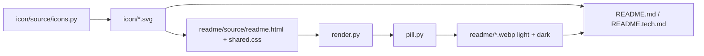

# Frontdoor - Asset Topology

## Layout

| Path | Role | Tracked |
|---|---|---|
| `.frontdoor/round-1` ... `round-8/` | logo exploration pages and renders | no (gitignored) |
| `.frontdoor/directions.html` | local design board | no |
| `docs/assets/icon/source/icons.py` | self-contained source of every content icon | yes (new) |
| `docs/assets/icon/*.svg` | 31 marks, light and `-dark` | yes (new) |
| `docs/assets/readme/source/readme.html` | source of every README image, one `.item` per image | yes (new) |
| `docs/assets/readme/source/shared.css`, `shared.js` | tokens and `?theme=` switch | yes (new) |
| `docs/assets/readme/source/pill.py` | cuts `nav-*` and `eng-*` renders to frameless pills | yes (new) |
| `docs/assets/readme/*.webp` | rendered images, `<id>.webp` and `<id>-dark.webp` | yes (new) |
| `README.md`, `README.tech.md` | consumers of the images and icons | yes |

## Flow

## Commands

- Icons: `uv run python -I docs/assets/icon/source/icons.py docs/assets/icon`
- Render all images: `uvx --from playwright --with pillow python -I <frontdoor-illustrate>/scripts/render.py docs/assets/readme/source/readme.html --root docs/assets --out docs/assets/readme`; `--root` is `docs/assets` so the page can load `../../icon/`.
- Then cut the pills: `uv run --with pillow python -I docs/assets/readme/source/pill.py docs/assets/readme`. Re-run after every render, since the render restores the frame.
- Render a subset: append `--items hero,stats`.

## Item ids in readme.html

`hero`, `problem`, `pipeline`, `posture-maintain`, `posture-adapt`, `posture-accelerate`, `stats`, `before-after`, `tech-cta`; nav pills `nav-video`, `nav-how`, `nav-architecture`, `nav-quickstart`, `nav-engineering`, `nav-iac`; engineering contents pills `eng-architecture`, `eng-reflexion`, `eng-scoring`, `eng-evidence`, `eng-trust`, `eng-cost`, `eng-iac`, `eng-invariants`, `eng-quickstart`, `eng-docs`, `eng-stack`.

- `.sub` (subtitle) and `.line` (tagline) styles live in the `readme.html` style block; a hero sketch ported from `.frontdoor/round-<N>/` must bring its classes with it, or the subtitle renders in the fallback body font.
- Pill and posture items set `width:max-content` instead of 1200 px, so each image is sized to its content.
