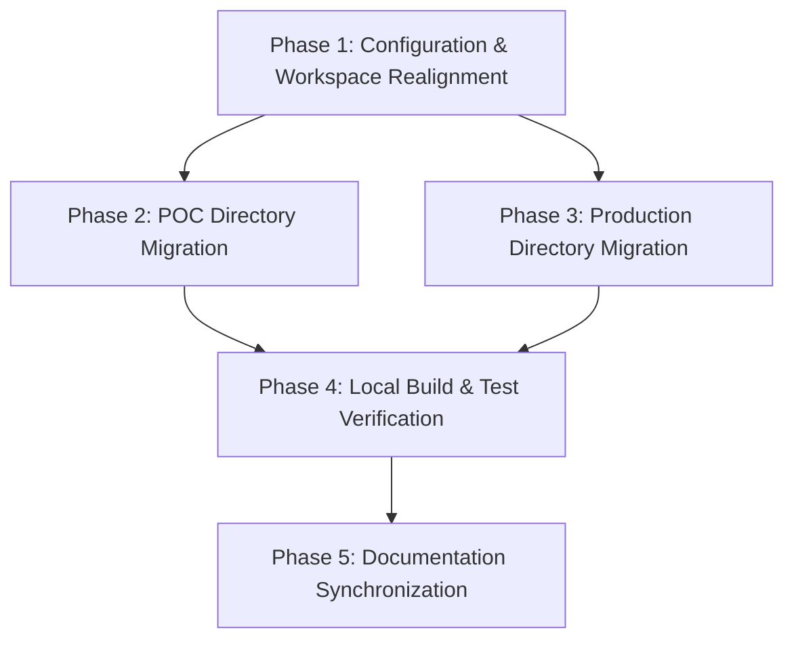

# SignalScout Repository Restructure - Roadmap

## Phases

| Phase | Description | Status | Open questions |
|---|---|---|---|
| Phase 1 | Configuration & Workspace Realignment (`vercel.json`, `package.json`) | completed | - |
| Phase 2 | POC Directory Migration (`signalscout-poc/`) | completed | - |
| Phase 3 | Production Directory Migration & Scaffolding (`signalscout-prod/`) | completed | - |
| Phase 4 | Local Build & Test Verification | completed | - |
| Phase 5 | Documentation & Cross-Reference Synchronization | completed | - |

## Phase Details and Acceptance Gates

### Phase 1: Configuration & Workspace Realignment (`vercel.json`, `package.json`)
- Objectives: Update the repository root deployment and build configuration files to prepare for the new subfolder structure.
- Scope: `vercel.json`, `package.json`, `.gitignore`.
- Acceptance Gate: In `vercel.json`, `services.frontend.root` points to `signalscout-poc/frontend` and `services.backend.root` points to `signalscout-poc/backend`. In root `package.json`, `workspaces` array declares `["signalscout-poc/backend", "signalscout-poc/frontend"]`.
- Final Evidence: `vercel.json` updated with `"root": "signalscout-poc/frontend"` and `"root": "signalscout-poc/backend"`; `package.json` workspaces array set to `["signalscout-poc/backend", "signalscout-poc/frontend"]`.

### Phase 2: POC Directory Migration (`signalscout-poc/`)
- Objectives: Move existing POC `backend/` and `frontend/` directories into `signalscout-poc/` using git tracking.
- Scope: `signalscout-poc/backend/`, `signalscout-poc/frontend/`.
- Acceptance Gate: All files from `backend/` and `frontend/` are moved into `signalscout-poc/` via `git mv`. `package.json` inside each package retains its package name (`@corpwatch/backend` and `@corpwatch/frontend`). `backend/vercel.json` survives intact under `signalscout-poc/backend/vercel.json`.
- Final Evidence: `git status` shows 100% clean rename detection (`R`) for all backend and frontend files into `signalscout-poc/`.

### Phase 3: Production Directory Migration & Scaffolding (`signalscout-prod/`)
- Objectives: Move `terraform/` into `signalscout-prod/terraform/` and scaffold directory structures for future production application code.
- Scope: `signalscout-prod/terraform/`, `signalscout-prod/agents/`, `signalscout-prod/lambdas/`.
- Acceptance Gate: Existing `terraform/` tree moved to `signalscout-prod/terraform/` via `git mv`. Directory structure created for `signalscout-prod/agents/` (Python Strands Agents) and `signalscout-prod/lambdas/` (Webhook-Handler Lambda).
- Final Evidence: `git status` verifies `terraform/` cleanly renamed to `signalscout-prod/terraform/`; scaffolding directories created with `.gitkeep`.

### Phase 4: Local Build & Test Verification
- Objectives: Validate all build steps, test suites, and typechecks across both environments under the restructured layout.
- Scope: Root build scripts and Terraform unit tests.
- Acceptance Gate: `npm run build` runs `build:case`, `validate:public-bundle`, and builds the frontend bundle without errors. `npm run typecheck` and `npm test` exit with code 0 across workspaces. `terraform -chdir=signalscout-prod/terraform/environments/prod validate` and `terraform -chdir=signalscout-prod/terraform/environments/prod test` exit with 0 failures.
- Final Evidence: `npm run build` succeeded with valid case package build and Vite client build; `npm run typecheck` passed across workspaces; `npm test` passed 51/51 tests across backend and frontend; `terraform fmt -recursive -check signalscout-prod/terraform/` returned 0; `terraform -chdir=signalscout-prod/terraform/environments/prod test` passed 1/1 test.

### Phase 5: Documentation & Cross-Reference Synchronization
- Objectives: Synchronize path references across repository documentation and existing baseline packs.
- Scope: `README.md`, `docs/baseline/terraform-prod.*`, `docs/production/architecture.md`.
- Acceptance Gate: References to `terraform/` in `docs/baseline/terraform-prod.*` updated to `signalscout-prod/terraform/`. Root `README.md` updated to document the new `signalscout-poc/` and `signalscout-prod/` directory topology.
- Final Evidence: `docs/baseline/terraform-prod.{introduction,roadmap,sourcecode,useguide}.md` and root `README.md` updated with `signalscout-prod/terraform/` paths; grep confirmed zero stale path references.

## Dependencies

## Risks

| Risk | Impact | Mitigation |
|---|---|---|
| Vercel build fails due to missing paths | Production demo outage on Vercel | Perform atomic commit with updated `vercel.json` and `package.json` in the same commit as directory movement. |
| Relative file paths in backend scripts break | Case builder or bundle validator scripts fail | Verified `build-case.ts` and `validate-public-bundle.ts` resolve `../../frontend` correctly inside `signalscout-poc/`. |
| Terraform test paths become invalid | IaC offline testing fails | Verified `terraform -chdir=signalscout-prod/terraform/environments/prod test` runs and passes. |

## Next Action
All 5 phases of the repository restructure roadmap are completed, verified offline, and committed on branch `main` (commits `15401f9` and `b83f131`). Next action is pushing the updated branch to remote (`git push --force-with-lease origin main`) and proceeding to production agent implementation under `signalscout-prod/agents/`.

