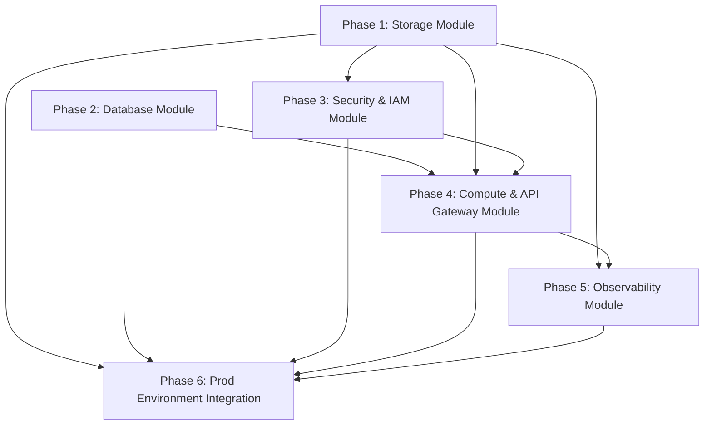

# SignalScout Production Terraform Infrastructure - Roadmap

## Phases

| Phase | Description | Status | Open questions |
|---|---|---|---|
| Phase 1 | Foundation & Storage Module (`modules/storage`) | completed | - |
| Phase 2 | Database Module (`modules/database`) | completed | - |
| Phase 3 | Security & IAM Module (`modules/security_iam`) | completed | - |
| Phase 4 | Compute & API Gateway Module (`modules/api_gateway_compute`) | completed | - |
| Phase 5 | Observability Module (`modules/observability`) | completed | - |
| Phase 6 | Prod Environment Integration & End-to-End Test (`environments/prod`) | completed | - |

## Phase Details and Acceptance Gates

### Phase 1: Foundation & Storage Module (`modules/storage`)
- Objectives: Create the reusable storage module managing the S3 raw market news bucket.
- Scope: `terraform/modules/storage/{terraform.tf,main.tf,variables.tf,outputs.tf,locals.tf,tests/storage_unit_test.tftest.hcl}`.
- Acceptance Gate: S3 bucket created with private access block, server-side encryption SSE-S3 enabled, Intelligent-Tiering transition rules configured, versioning enabled, `Name` tag declared, and zero `#` comments in `.tf` files. `terraform test` in plan mode with mock provider passes all assertions.
- Final Evidence: `terraform -chdir=terraform/modules/storage test` succeeded with 2 passed, 0 failed.

### Phase 2: Database Module (`modules/database`)
- Objectives: Create the reusable database module managing DynamoDB state tables.
- Scope: `terraform/modules/database/{terraform.tf,main.tf,variables.tf,outputs.tf,locals.tf,tests/database_unit_test.tftest.hcl}`.
- Acceptance Gate: Tables `MarketThemes` (PK `theme_id`) and `PipelineState` (PK `run_id`) created with On-Demand billing mode (`PAY_PER_REQUEST`), Point-In-Time Recovery (PITR) enabled, server-side encryption enabled, explicit `Name` tags, and passing mock unit tests.
- Final Evidence: `terraform -chdir=terraform/modules/database test` succeeded with 2 passed, 0 failed.

### Phase 3: Security & IAM Module (`modules/security_iam`)
- Objectives: Create Secrets Manager secret containers and decoupled least-privilege IAM execution roles.
- Scope: `terraform/modules/security_iam/{terraform.tf,main.tf,variables.tf,outputs.tf,locals.tf,tests/security_iam_unit_test.tftest.hcl}`.
- Acceptance Gate: Secrets Manager secret created for webhook HMAC signing key. Independent IAM roles created for Crawler (`s3:PutObject` only, no wildcards), Management (`s3:GetObject` only, Bedrock), Analysis (Bedrock Guardrails only), and Lambda Webhook-Handler. Unit tests pass with zero policy syntax errors.
- Final Evidence: `terraform -chdir=terraform/modules/security_iam test` succeeded with 1 passed, 0 failed.

### Phase 4: Compute & API Gateway Module (`modules/api_gateway_compute`)
- Objectives: Create the HTTP API Gateway, webhook route, Lambda handler skeleton, and Bedrock Guardrails.
- Scope: `terraform/modules/api_gateway_compute/{terraform.tf,main.tf,variables.tf,outputs.tf,locals.tf,tests/api_gateway_compute_unit_test.tftest.hcl}`.
- Acceptance Gate: API Gateway HTTP API configured with `$default` auto-deploy stage, route `POST /webhooks/langfuse` pointing to Lambda integration without Cognito authorizer, Lambda handler environment variables (`MAX_RETRY = 2`, table names), and Bedrock Guardrails resource created with prompt-attack filters. Mock unit tests pass.
- Final Evidence: `terraform -chdir=terraform/modules/api_gateway_compute test` succeeded with 1 passed, 0 failed.

### Phase 5: Observability Module (`modules/observability`)
- Objectives: Provision CloudWatch Log Groups, metric alarms, and CloudTrail audit trails.
- Scope: `terraform/modules/observability/{terraform.tf,main.tf,variables.tf,outputs.tf,locals.tf,tests/observability_unit_test.tftest.hcl}`.
- Acceptance Gate: CloudWatch Log Groups configured with 30-day retention, metric alarms for API Gateway 5XX errors and Lambda errors, and CloudTrail trail with dedicated S3 bucket configured. Mock unit tests pass.
- Final Evidence: `terraform -chdir=terraform/modules/observability test` succeeded with 1 passed, 0 failed.

### Phase 6: Prod Environment Integration & End-to-End Test (`environments/prod`)
- Objectives: Assemble all 5 modules under `environments/prod/` and provide end-to-end integration tests.
- Scope: `terraform/environments/prod/{terraform.tf,providers.tf,main.tf,variables.tf,outputs.tf,locals.tf,backend-prod.hcl,backend-floci.hcl,floci.tfvars,terraform.tfvars.example,tests/prod_unit_test.tftest.hcl}`.
- Acceptance Gate: Root module wires all 5 modules cleanly with input variables and outputs, backend S3 declares partial config, `terraform fmt -check` passes across repository, `terraform validate` exits 0, and root integration test with mock provider passes all assertions.
- Final Evidence: `terraform -chdir=terraform/environments/prod test` succeeded with 1 passed, 0 failed; `terraform fmt -recursive -check terraform/` returned 0; `terraform validate` returned valid for all configurations.

## Dependencies

## Risks

| Risk | Impact | Mitigation |
|---|---|---|
| Local AWS profile lacks S3/IAM permissions | Live apply operations fail with AccessDenied | Use Terraform native mock providers (`mock_provider "aws"`) to test 100% of HCL logic and assertions offline without live AWS calls. |
| Formatting and comment policy drift | Resource replacement triggered by template changes | Enforce zero `#` comments in `.tf` files and automated `terraform fmt` checks in pre-commit/CI. |
| Inadvertent secret leakage in outputs | Sensitive credentials exposed in state/console | Mark all secret-bearing variables and outputs with `sensitive = true`. |

## Next Action
All 6 implementation phases are complete and verified. Ready for local emulation deployment on Floci container (`http://localhost:4566`) or git staging/committing upon user instruction.
