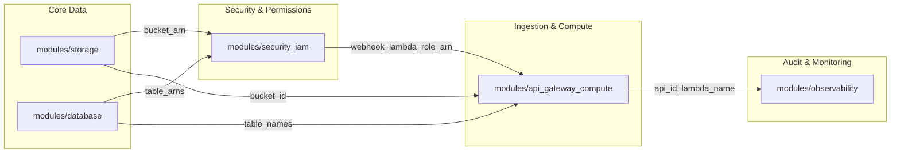

# SignalScout Production Terraform Infrastructure - Code Topology

## Directory Topology

```text
signalscout-prod/terraform/
├── modules/
│   ├── storage/
│   │   ├── terraform.tf                      # Terraform floor >= 1.14 and AWS provider >= 5.80.0
│   │   ├── main.tf                           # S3 raw-market-news bucket, Intelligent-Tiering, SSE, public access block
│   │   ├── variables.tf                      # Bucket name, environment, lifecycle configurations
│   │   ├── outputs.tf                        # bucket_arn, bucket_id, bucket_domain_name
│   │   ├── locals.tf                         # Resource naming prefix and common tags
│   │   └── tests/
│   │       └── storage_unit_test.tftest.hcl  # Plan mode test verifying encryption, tiering, and naming tags
│   ├── database/
│   │   ├── terraform.tf
│   │   ├── main.tf                           # DynamoDB MarketThemes & PipelineState tables, PITR, KMS encryption
│   │   ├── variables.tf                      # Table name overrides, billing mode, tags
│   │   ├── outputs.tf                        # market_themes_table_arn, pipeline_state_table_arn
│   │   ├── locals.tf
│   │   └── tests/
│   │       └── database_unit_test.tftest.hcl # Plan mode test verifying On-Demand billing, keys, and PITR
│   ├── security_iam/
│   │   ├── terraform.tf
│   │   ├── main.tf                           # Secrets Manager secret + IAM execution roles for Crawler, Management, Analysis, Lambda
│   │   ├── variables.tf                      # S3 bucket ARN, DynamoDB table ARNs, role prefix
│   │   ├── outputs.tf                        # crawler_role_arn, management_role_arn, analysis_role_arn, webhook_lambda_role_arn
│   │   ├── locals.tf
│   │   └── tests/
│   │       └── security_iam_unit_test.tftest.hcl # Plan mode test verifying least-privilege actions and explicit ARNs
│   ├── api_gateway_compute/
│   │   ├── terraform.tf
│   │   ├── main.tf                           # HTTP API Gateway, webhook route, Lambda Webhook-Handler, Bedrock Guardrail
│   │   ├── variables.tf                      # Lambda role ARN, DynamoDB table names, S3 bucket name, max_retry
│   │   ├── outputs.tf                        # api_endpoint, webhook_url, guardrail_arn, guardrail_id
│   │   ├── locals.tf
│   │   └── tests/
│   │       └── api_gateway_compute_unit_test.tftest.hcl # Plan mode test verifying route, stage, and Guardrail filters
│   └── observability/
│       ├── terraform.tf
│       ├── main.tf                           # CloudWatch Log Groups, metric alarms (5XX, retry limit), CloudTrail trail
│       ├── variables.tf                      # API Gateway ID, retention days, alarm notification ARN
│       ├── outputs.tf                        # cloudwatch_log_group_arns, cloudtrail_arn
│       ├── locals.tf
│       └── tests/
│           └── observability_unit_test.tftest.hcl # Plan mode test verifying log retention and metric thresholds
└── environments/
    └── prod/
        ├── terraform.tf                      # Partial S3 backend configuration
        ├── providers.tf                      # AWS provider with dual-mode support for live AWS and Floci local emulator
        ├── main.tf                           # Invokes all 5 modules and binds inputs/outputs
        ├── variables.tf                      # Environment-level variables with validation and defaults
        ├── outputs.tf                        # Production endpoints, bucket ARNs, and table names
        ├── locals.tf                         # Environment naming conventions
        ├── backend-prod.hcl                  # Remote S3 backend config with use_lockfile = true
        ├── backend-floci.hcl                 # Floci local S3 backend config (endpoint localhost:4566)
        ├── floci.tfvars.example              # Sample variables configuration for Floci local testing
        ├── terraform.tfvars.example          # Sample environment variable values for live AWS deployment
        └── tests/
            └── prod_unit_test.tftest.hcl     # End-to-end root plan test verifying full module orchestration
```

## Module Dependency Graph



## Variable and Output Contract Matrix

| Source module | Output name | Target module | Target variable name | Purpose |
|---|---|---|---|---|
| `modules/storage` | `bucket_arn` | `modules/security_iam` | `raw_market_news_bucket_arn` | Scopes IAM `s3:PutObject` (Crawler) and `s3:GetObject` (Management) to exact bucket ARN |
| `modules/storage` | `bucket_id` | `modules/api_gateway_compute` | `raw_market_news_bucket_id` | Injects target S3 bucket name into Lambda Webhook-Handler environment variables |
| `modules/database` | `market_themes_table_arn` | `modules/security_iam` | `market_themes_table_arn` | Grants Lambda Webhook-Handler least-privilege `dynamodb:UpdateItem` / `PutItem` access |
| `modules/database` | `pipeline_state_table_arn` | `modules/security_iam` | `pipeline_state_table_arn` | Grants Lambda Webhook-Handler atomic counter update access (`ADD retry_count :inc`) |
| `modules/database` | `market_themes_table_name` | `modules/api_gateway_compute` | `market_themes_table_name` | Configures Lambda environment variable for display table lookups |
| `modules/database` | `pipeline_state_table_name` | `modules/api_gateway_compute` | `pipeline_state_table_name` | Configures Lambda environment variable for atomic retry count operations |
| `modules/security_iam` | `webhook_lambda_role_arn` | `modules/api_gateway_compute` | `lambda_execution_role_arn` | Attaches least-privilege execution role to Lambda Webhook-Handler |
| `modules/api_gateway_compute` | `api_gateway_id` | `modules/observability` | `http_api_id` | Targets CloudWatch metric alarms for API Gateway 5XX errors |
